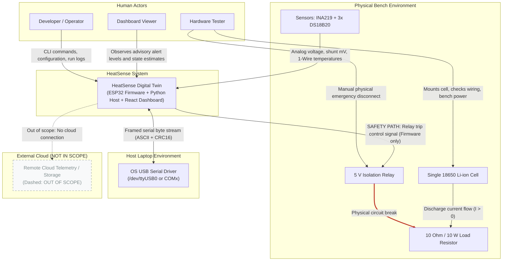

# System Context Architecture (C4 Level 1)

Status: Draft for review
Last updated: 2026-10-26
Implements goals: G1, G2, G3
Implemented by: Prompt 03, Prompt 04, Prompt 09, Prompt 10, Prompt 11

## Purpose

This document defines the C4 Level 1 System Context for HeatSense. It establishes the boundary separating the HeatSense software and hardware system from external actors, operating system drivers, the physical battery cell test bench, and out-of-scope cloud environments.

## Scope

This specification covers the primary human actors, the external hardware components under observation, operating system interfaces, boundary crossing protocols, trust boundaries, and explicit out-of-scope declarations. It applies to single-cell lithium-ion 18650 testing environments.

## Context Diagram

### Safety Path Legend
1. **SAFETY PATH (Red Bold Line)**: Sensor acquisition $\rightarrow$ ESP32 firmware threshold evaluation $\rightarrow$ GPIO low/high trip $\rightarrow$ Relay hardware coil de-energization $\rightarrow$ Load isolation. This path executes exclusively within local firmware and hardware circuits; it never passes through the host laptop OS, Python code, or web UI.

### Context Diagram Elements

| Element Name | Category | Plain Language Description |
| :--- | :--- | :--- |
| **Developer / Operator** | Human Actor | Engineer who launches the host software, configures parameters, initiates sessions, and inspects diagnostic logs. |
| **Hardware Tester** | Human Actor | Qualified person physically handling the 18650 battery cell, verifying electrical wiring, calibrating bench instruments, and overseeing physical safety. |
| **Dashboard Viewer** | Human Actor | Observer monitoring real-time battery status, advisory warnings, and state of charge via the web browser. |
| **HeatSense Digital Twin** | System Boundary | The complete HeatSense solution comprising embedded ESP32 firmware, Python host estimation engine, local SQLite database, and web dashboard. |
| **Single 18650 Li-ion Cell** | Physical Hardware | The single lithium-ion electrochemical cell under test (nominal 3.6 V / 3.7 V, Samsung INR18650-25R reference). |
| **10 Ohm / 10 W Load Resistor** | Physical Hardware | The passive resistive discharge load that draws approximately 0.42 A at 4.2 V. |
| **5 V Isolation Relay** | Physical Hardware | Electromechanical relay wired in a Normally Open (NO) safety configuration to interrupt the load discharge circuit upon command or fault. |
| **Sensors (INA219 + DS18B20)** | Physical Hardware | INA219 high-side I2C voltage/current monitor and three DS18B20 digital 1-Wire temperature sensors mounted on the cell surface. |
| **OS USB Serial Driver** | Laptop OS | Operating system kernel device driver providing virtual COM port or tty serial communication over USB. |
| **Remote Cloud Telemetry** | External (Out of Scope) | Any internet-based telemetry, cloud database, or remote fleet management platform (explicitly excluded from HeatSense). |

## Actors and Operational Boundaries

| Actor | Primary Goal | Permitted Actions | Strictly Prohibited Actions |
| :--- | :--- | :--- | :--- |
| **Developer / Operator** | Run estimation pipeline, debug algorithms, record experimental data | Start/stop host services, configure session metadata, select estimation strategies, send advisory `ARM`/`DISARM` requests | Cannot alter firmware safety thresholds; cannot override a firmware latched fault; cannot bypass safety interlocks |
| **Hardware Tester** | Safely conduct physical cell characterization experiments | Insert/remove cell, connect wiring, inspect thermistor thermal bonding, verify fuse ratings, trigger manual power switch | Cannot modify safety limits without formal datasheet sign-off; cannot operate cell without protective enclosure |
| **Dashboard Viewer** | Monitor battery health and advisory alert status | View live charts, inspect estimated SoC, read advisory notices, export historical session summaries | Cannot dispatch direct hardware commands; cannot alter system configurations |

## Boundary Crossing Protocols and Trust Levels

| Interface / Boundary | Direction | Physical / Transport Medium | Data Format | Trust Level |
| :--- | :--- | :--- | :--- | :--- |
| **Sensors $\rightarrow$ ESP32** | Inbound | Hardware I2C (400 kHz) and 1-Wire bus | Binary register values, digital temperature counts | **UNTRUSTED**: Hardware lines may suffer electrical noise, bus lockups, or probe disconnects |
| **ESP32 $\rightarrow$ Relay** | Outbound | Direct microcontroller GPIO logic line | Discrete voltage level (active state drives coil) | **CRITICAL SAFETY**: Autonomous firmware actuation owning physical safety |
| **ESP32 $\leftrightarrow$ Host Laptop** | Bi-directional | USB Serial (CDC-ACM virtual COM) | Framed ASCII lines with 16-bit CRC checksum | **UNTRUSTED**: Host treats all incoming device serial bytes as untrusted and potentially malformed |
| **Host $\leftrightarrow$ Dashboard** | Bi-directional | Loopback TCP (HTTP REST + WebSockets) | JSON text payloads over localhost (`127.0.0.1`) | **INTERNAL TRUSTED**: Local single-user communication; external network traffic blocked |

## Out of Scope Declarations

The following capabilities are explicitly outside the scope of HeatSense and will not be implemented:
1. **Cloud Services**: No remote servers, cloud databases, external telemetry streaming, or telemetry relays.
2. **Multi-Cell Packs / Modules**: No series/parallel pack balancing, cell-to-cell interconnections, or high-voltage BMS features.
3. **Destructive Testing**: No mechanical crush, nail penetration, over-temperature thermal runaway triggering, or external fire testing.
4. **Vehicle Integration**: No CAN bus automotive integration, OBD-II interfaces, or traction inverter coupling.
5. **Regulatory Certification Claims**: HeatSense is a research prototype; it does not claim compliance with UL 1642, IEC 62133, or ISO 26262.

## Offline Statement

HeatSense is strictly an offline-first system:
- All core functionalities—telemetry acquisition, frame decoding, physical state estimation (2RC ECM, EKF), thermal modeling, advisory alert evaluation, local SQLite session storage, and web dashboard visualization—operate without an active internet or local area network connection.
- Software dependencies are packaged and installed locally. The web dashboard SPA is served directly from the local host HTTP server.

## Rules and Invariants

1. **Safety Path Primacy**: The safety trip path from sensors through firmware to relay hardware must never traverse the host laptop or any host software component.
2. **Untrusted Ingress**: All data received from the physical microcontroller or serial interface is untrusted and must undergo rigorous checksum verification, decoding validation, and plausibility boundary checks before ingestion.
3. **No Cloud Dependency**: No software module may attempt external network requests, phone-home telemetry, or cloud licensing checks.

## Decisions Referenced

- [ADR-0001](../adr/0001-repository-layout.md): Monorepo layout with sibling safety boundaries and hexagonal host.
- [ADR-0003](../adr/0003-telemetry-transport-ascii-crc16.md): Telemetry transport format: ASCII framed lines with CRC16.
- [ADR-0004](../adr/0004-host-device-command-subset.md): Host-to-device commands limited to PING, ARM, DISARM, SET_RATE.
- [ADR-0014](../adr/0014-localhost-only-api-binding.md): Local-only API binding to 127.0.0.1 without authentication.

## Traceability

| Element | Implemented in Prompt | Verified by Which Test or Gate |
| :--- | :--- | :--- |
| System Boundary & Actor Policies | Prompt 03 | Documentation gate (`scripts/check_docs.py`) |
| Safety Path Isolation | Prompt 03, Prompt 11, Prompt 12 | Hardware safety bench test and host disconnection test |
| Untrusted Serial Ingress Boundary | Prompt 04 | Property-based fuzzer (`host/tests/property/`) |
| Localhost Network Boundary | Prompt 09 | Loopback binding integration test |
| Offline-First Operation | Prompt 12 | Network isolation end-to-end integration test |

## Open Questions

- `OQ-001`: Latched fault clearing mechanism: Is power cycling acceptable or is a physical reset button required? (Owner: Hardware Teammate / Human, Blocks: Prompt 11).
- `OQ-009`: Open-source license selection for the repository (Owner: Human, Blocks: Prompt 12).
