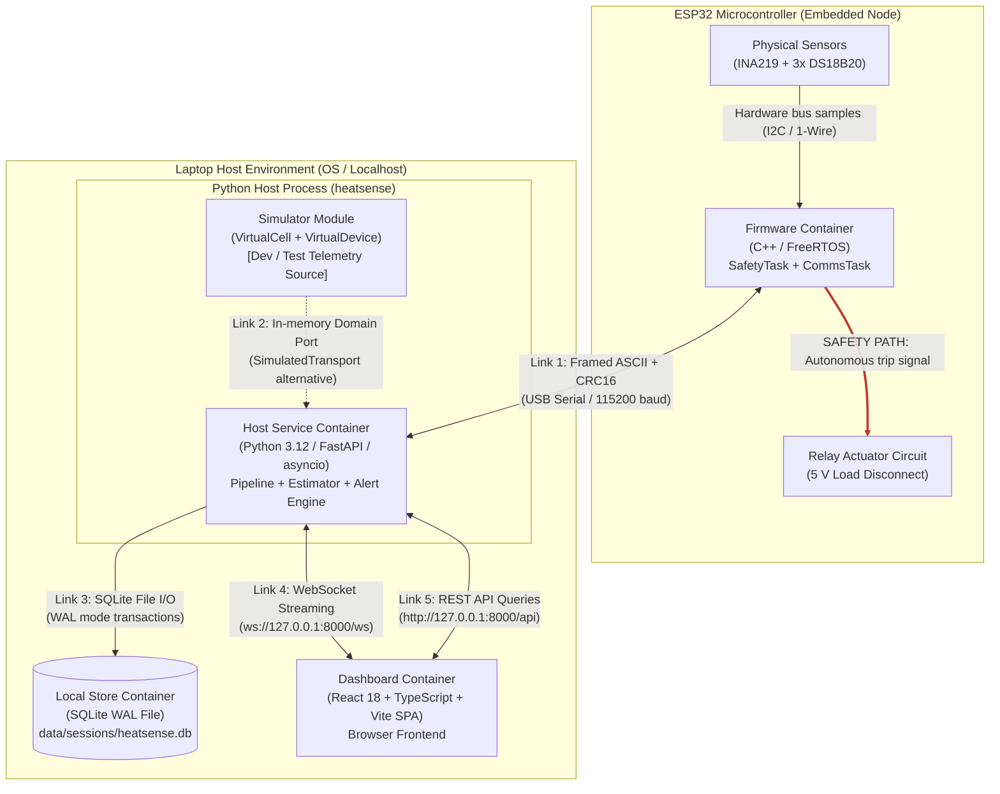

# Containers Architecture (C4 Level 2)

Status: Draft for review
Last updated: 2026-10-26
Implements goals: G1, G2, G3, G7
Implemented by: Prompt 03, Prompt 04, Prompt 06, Prompt 08, Prompt 09, Prompt 10, Prompt 11

## Purpose

This document defines the C4 Level 2 Containers architecture for HeatSense. It establishes the high-level executable containers, their runtime environments, communication protocols, failure interaction boundaries, and data ownership models.

## Scope

This specification covers the five primary software and hardware containers: Embedded Firmware (ESP32), Host Service (Python process), Web Dashboard (browser SPA), Local Store (SQLite database), and the Software Simulator (in-process Python module). It defines their physical deployment and operational boundaries.

## Containers Diagram

### Safety Path Legend
1. **SAFETY PATH (Red Bold Line)**: `FwContainer` $\rightarrow$ `RelayDriver`. The trip command executes strictly within the embedded microcontroller firmware. It has zero software dependencies on the Python host, the laptop operating system, or the browser UI.

### Containers Element Descriptions

| Container Name | Runtime Environment | Technology Stack | Plain Language Description |
| :--- | :--- | :--- | :--- |
| **Firmware Container** | ESP32-WROOM-32 MCU | Embedded C++ (PlatformIO / FreeRTOS) | Autonomous embedded monitor executing dual tasks: `SafetyTask` (deterministic limit evaluation) and `CommsTask` (serial telemetry streaming). |
| **Host Service Container** | Laptop Operating System | Python 3.12 (FastAPI, asyncio, NumPy) | Central digital twin backend service. Ingests serial frames, executes physical state estimators (2RC ECM, EKF), evaluates advisory alerts, and serves API/WebSockets. |
| **Simulator Module** | Inside Host Process | Python 3.12 (domain port adapter) | High-fidelity synthetic cell and sensor simulator. Connects to the host pipeline via domain ports, providing hardware-independent testing and scenario playback. |
| **Dashboard Container** | Web Browser (Chromium / Firefox) | React 18, TypeScript, Vite, uPlot | Single-page application rendering live 10 Hz telemetry streams, physical state estimates, polarizations, advisory alert badges, and historical session logs. |
| **Local Store Container** | Laptop Local Filesystem | SQLite 3 (Write-Ahead Logging mode) | Zero-configuration local database persisting structured time-series samples, calculated state innovations, session metadata, and system events. |

## Deployment and Network Configuration

All HeatSense software components execute locally on a single developer or operator laptop, with the exception of the firmware executing on the physical ESP32 microcontroller connected via USB.

| Container | Host Node | Network / Interface Bind | Port / Path | Default Value (PROVISIONAL) |
| :--- | :--- | :--- | :--- | :--- |
| **Firmware Container** | ESP32 Microcontroller | USB CDC-ACM Serial | `/dev/ttyUSB0` or `COM3` | 115200 baud, 8N1 (PROVISIONAL: see `OQ-005`) |
| **Host Service (REST)** | Laptop OS | Loopback TCP (`127.0.0.1`) | HTTP TCP Port | `8000` (Configurable via `HEATSENSE_API_PORT`) |
| **Host Service (WebSocket)** | Laptop OS | Loopback TCP (`127.0.0.1`) | WS TCP Path | `ws://127.0.0.1:8000/ws` |
| **Dashboard SPA** | Browser / Laptop | Served via Host HTTP Server | HTTP Web Path | `http://127.0.0.1:8000/` (or Vite dev `5173`) |
| **Local Store** | Laptop OS Filesystem | Local File System Path | SQLite DB Path | `data/sessions/heatsense.db` |

## Container Responsibilities and Anti-Behaviors

| Container | Primary Responsibilities | Strict Prohibitions (Must NEVER Do) |
| :--- | :--- | :--- |
| **Firmware Container** | - Sample INA219 and DS18B20 at 10 Hz - Enforce hardwired safety trip limits - Control physical 5 V relay coil - Format and transmit ASCII telemetry frames | - **MUST NEVER** wait or block for host communication before evaluating safety limits. - **MUST NEVER** accept remote host commands that modify safety limits or clear latched faults. - **MUST NEVER** keep the relay closed when any limit is violated. |
| **Host Service Container** | - Ingest and validate serial telemetry frames - Estimate hidden physical states (SoC, polarizations) - Detect precursor impedance and thermal anomalies - Persist session telemetry and state to SQLite - Stream real-time data to dashboard | - **MUST NEVER** attempt to command the relay closed when the device reports a fault. - **MUST NEVER** decide `RED` alert level autonomously (only devices report `RED`). - **MUST NEVER** block telemetry ingestion when a downstream UI client slows down. |
| **Dashboard Container** | - Render real-time electrical and thermal graphs - Display advisory alert banners with plain copy - Allow operator initiation of advisory ARM/DISARM - Provide session replay and CSV export | - **MUST NEVER** communicate directly with the ESP32 hardware (must route through Host API). - **MUST NEVER** present uncalibrated or provisional estimates as laboratory measurements. - **MUST NEVER** freeze when network or WebSocket connection drops. |
| **Local Store Container** | - Atomically record time-series samples via WAL - Maintain relational integrity of sessions and events - Support fast indexed queries for historical playback | - **MUST NEVER** require an external database server daemon. - **MUST NEVER** block memory-mapped WAL reads during continuous append streaming. |
| **Simulator Module** | - Numerically integrate 2RC ECM and thermal models - Inject sensor noise, quantization, and fault modes - Deliver deterministic synthetic telemetry | - **MUST NEVER** expose ground-truth internal variables to production pipeline estimators. - **MUST NEVER** require different application pipeline code than physical hardware. |

## Failure and Disconnect Matrix

| If This Container Fails... | Impact on Firmware | Impact on Host Service | Impact on Dashboard | Impact on Local Store |
| :--- | :--- | :--- | :--- | :--- |
| **Firmware Disconnects / Crashes** | Microcontroller reboots or hangs; relay de-energizes to open (safe state). | Enters `RECONNECTING` state with exponential backoff; logs session communication gap. | Displays "Device Disconnected" advisory badge; pauses live chart scrolling; retains history. | Active transaction completes; session record remains cleanly closed or marked interrupted. |
| **Host Service Crashes** | Firmware continues autonomous safety monitoring; if ARMED, continues discharge until UVP trips or timer expires. | Process terminates; OS frees serial port lock. | Displays "Backend Unavailable" reconnect modal; attempts WebSocket reconnection. | SQLite WAL safely recovers on next process startup; uncommitted write buffer is rolled back. |
| **Dashboard Browser Closes** | Zero impact. Firmware operates unaffected. | Host detects WebSocket client disconnect; tears down client queue; ingestion continues. | Container terminated by user. | Zero impact. Telemetry persistence continues without frame drops. |
| **Local Store Disk Full / I/O Error**| Zero impact. Firmware operates unaffected. | Persistence stage flags `STORAGE_ERROR`; alerts operator; live streaming continues via ring buffer. | Displays persistent warning banner: "Local persistence degraded - disk error". | Database enters read-only mode to prevent corruption. |

## Data Ownership Matrix

| Data Entity | Authoritative Owner | Secondary Consumer(s) | Persistence Mechanism |
| :--- | :--- | :--- | :--- |
| **Raw Telemetry Frames** | Firmware Container | Host Service Container | Wire only; serialized in transit, decoded immediately. |
| **Calibrated Telemetry Samples** | Host Service (`IngestionService`) | Dashboard, SQLite, Estimator | Persisted to SQLite `samples` table. |
| **Estimated States & Innovations**| Host Service (`StateEstimator`) | Dashboard, SQLite, Alert Engine | Persisted to SQLite `estimates` table. |
| **Advisory Alerts & Level** | Host Service (`AlertEngine`) | Dashboard, SQLite, Operator | Persisted to SQLite `alerts` table. |
| **Hardware Safety Fault State** | Firmware Container | Host Service (Advisory relay) | Latched in ESP32 RAM / reported in frame `fault_mask`. |
| **Cell Physical Parameters** | Parameter Provider (YAML config) | Host Service, Estimator | Static YAML file in `host/parameters/`. |
| **Session Lifecycle Records** | Host Service (`SessionManager`) | Dashboard, SQLite | Persisted to SQLite `sessions` table. |

## Rules and Invariants

1. **Safety Loop Autonomy**: The Firmware Container must maintain its deterministic 10 Hz sampling and safety loop regardless of host availability, serial framing errors, or USB cable disconnections.
2. **Advisory Authority**: The Host Service Container and Dashboard Container are strictly advisory. Commands dispatched to the firmware (`ARM`, `DISARM`) are interpreted by firmware as advisory requests subject to local firmware pre-check validation.
3. **Localhost Isolation**: By default, all host network interfaces bind exclusively to `127.0.0.1`. Remote network access is rejected unless explicitly overridden by configuration.

## Decisions Referenced

- [ADR-0001](../adr/0001-repository-layout.md): Monorepo layout with sibling safety boundaries and hexagonal host.
- [ADR-0003](../adr/0003-telemetry-transport-ascii-crc16.md): Telemetry transport format: ASCII framed lines with CRC16.
- [ADR-0006](../adr/0006-sqlite-wal-local-storage.md): Local storage in SQLite with WAL.
- [ADR-0007](../adr/0007-websocket-live-rest-history.md): Live data over WebSocket, history over REST.
- [ADR-0010](../adr/0010-platformio-native-unity-firmware.md): PlatformIO Core CLI with native Unity tests for firmware core.
- [ADR-0011](../adr/0011-firmware-dual-task-concurrency.md): Firmware concurrency: SafetyTask and CommsTask.
- [ADR-0014](../adr/0014-localhost-only-api-binding.md): Local-only API binding to 127.0.0.1 without authentication.

## Traceability

| Element | Implemented in Prompt | Verified by Which Test or Gate |
| :--- | :--- | :--- |
| Firmware / Host Boundary | Prompt 04, Prompt 11 | Golden frame contract tests (`contracts/golden/`) |
| Simulator / Host Boundary | Prompt 06 | Simulator contract test suite (`host/tests/contract/`) |
| SQLite Storage Container | Prompt 08 | SQLite repository integration test (`host/tests/integration/`) |
| FastAPI REST / WebSocket Container | Prompt 09 | API endpoint unit and integration tests |
| Dashboard SPA Container | Prompt 10 | Dashboard end-to-end browser walkthrough |

## Open Questions

- `OQ-002`: Should the firmware enforce a maximum ARMED duration independent of the host? (Owner: Embedded Engineer / Systems Engineer, Blocks: Prompt 11).
- `OQ-004`: Relay module active level (active-HIGH vs active-LOW) and boot-time pin behaviour verification (Owner: Hardware Teammate, Blocks: Prompt 11).
