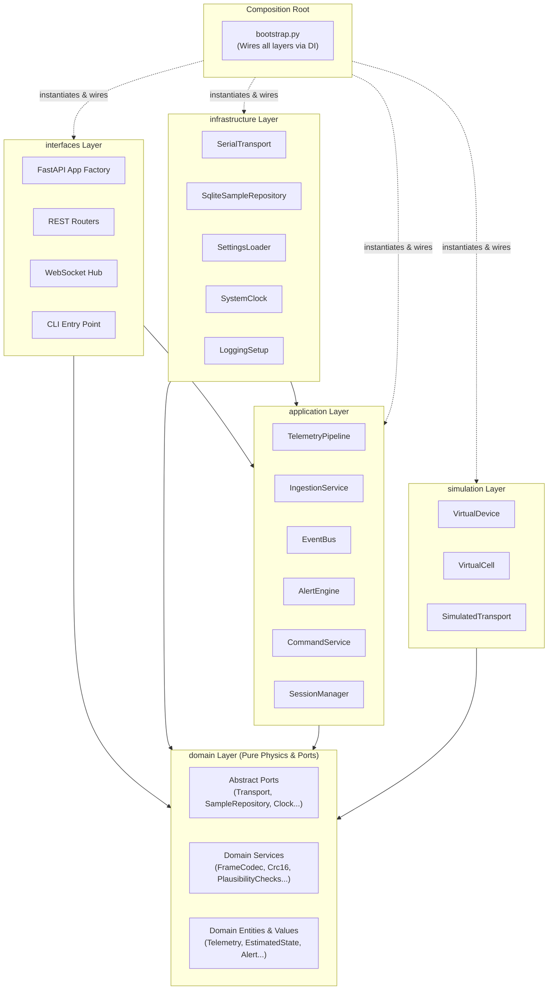
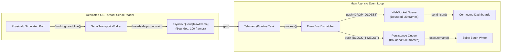

# Host Components Architecture (C4 Level 3)

Status: Draft for review
Last updated: 2026-10-26
Implements goals: G1, G2, G3, G7
Implemented by: Prompt 03, Prompt 05, Prompt 06, Prompt 07, Prompt 08, Prompt 09

## Purpose

This document defines the C4 Level 3 Host Components architecture for the HeatSense Python backend (`host/src/heatsense/`). It specifies the concentric layer structure, domain ports, concrete infrastructure adapters, application pipeline services, threading and concurrency models, and extension patterns.

## Scope

This specification covers all Python modules within `host/src/heatsense/` across the hexagonal layers: `domain`, `application`, `infrastructure`, `interfaces`, `simulation`, and the `bootstrap.py` composition root. It strictly enforces the dependency rules validated by `scripts/arch_guard.py`.

## Hexagonal Layer Hierarchy

The host architecture follows Clean / Hexagonal Architecture (ports and adapters). The dependency arrows point strictly inward toward the pure domain:

### Layer Hierarchy Elements

| Layer Name | Location | Allowed Imports | Forbidden Imports |
| :--- | :--- | :--- | :--- |
| **`domain`** | `host/src/heatsense/domain/` | Python stdlib, NumPy, typing_extensions | `application`, `infrastructure`, `interfaces`, `simulation`, `pydantic`, `fastapi`, `serial`, `sqlite3` |
| **`application`** | `host/src/heatsense/application/` | Python stdlib, NumPy, `domain` | `infrastructure`, `interfaces`, `simulation`, `fastapi`, `pydantic` |
| **`infrastructure`** | `host/src/heatsense/infrastructure/` | Python stdlib, `domain`, `application`, external I/O libs (`serial`, `sqlite3`, `yaml`) | `interfaces`, `simulation` |
| **`interfaces`** | `host/src/heatsense/interfaces/` | Python stdlib, `domain`, `application`, `fastapi`, `uvicorn`, `pydantic` | `infrastructure` directly (instances must be injected via `bootstrap.py`) |
| **`simulation`** | `host/src/heatsense/simulation/` | Python stdlib, NumPy, SciPy, `domain` | `infrastructure`, `interfaces` |
| **`bootstrap`** | `host/src/heatsense/bootstrap.py`| All layers (the only permitted multi-layer composition root) | `firmware` (host never imports firmware code) |

### Layer Component Catalogue

| Layer | Component Type | Component Names | Purpose / Responsibility |
| :--- | :--- | :--- | :--- |
| **`domain`** | Ports (Protocols) | `Transport`, `Clock`, `SampleRepository`, `EventPublisher`, `StateEstimator`, `AnomalyDetector`, `ParameterProvider` | Abstract interface contracts defining external capabilities. |
| **`domain`** | Services | `FrameCodec`, `Crc16`, `DeviceTimeUnwrapper`, `OcvCurve`, `CoulombCounterEstimator`, `NullEstimator`, `RingBuffer`, `PlausibilityChecks` | Pure mathematical models, unwrapping algorithms, baseline estimators, and ring buffers. |
| **`application`** | Pipeline & Services | `TelemetryPipeline`, `IngestionService`, `EventBus`, `SessionManager`, `AlertEngine`, `AlertStateMachine`, `DetectorRegistry`, `CommandService`, `ExperimentRunner` | Use case orchestration, linear stage execution, alert state machine, and command dispatch. |
| **`infrastructure`**| Adapters | `SerialTransport`, `SimulatedTransport`, `ReplayTransport`, `SqliteSampleRepository`, `SettingsLoader`, `LoggingSetup`, `SystemClock` | Concrete I/O adapters implementing domain ports using pyserial, sqlite3, and YAML. |
| **`interfaces`** | Web & CLI | FastAPI App Factory, REST Routers, WebSocket Hub, DTOs, CLI Entry Point | HTTP REST endpoints, streaming WebSocket hubs, schema validation, and terminal commands. |
| **`simulation`** | Simulator Core | `VirtualCell`, `SensorModels`, `LoadProfiles`, `FaultInjector`, `VirtualDevice`, `TruthProbe` | High-fidelity virtual cell dynamics, noise injectors, load profiles, and scenario runners. |
| **`bootstrap`** | Composition Root| `bootstrap.py` | Single composition root wiring concrete adapters to domain ports and application services. |

## Domain Ports Specification

Domain ports define abstract capabilities required by the domain and application layers. All ports are implemented as abstract base classes (`abc.ABC`) or `typing.Protocol` under `heatsense.domain.ports`.

| Port Name | Owner Layer | Primary Methods (Signatures & Meaning) | Failure Behavior | Planned Concrete Adapters | Contract Test Suite |
| :--- | :--- | :--- | :--- | :--- | :--- |
| **`Transport`** | `domain.ports` | `open() -> None` `close() -> None` `read_frame() -> RawFrame` `write_frame(bytes) -> None` | Raises `TransportError` on disconnect; returns `None` on read timeout | `SerialTransport`, `SimulatedTransport`, `ReplayTransport` | `tests/contract/test_transport_contract.py` |
| **`Clock`** | `domain.ports` | `now_s() -> float` `sleep(seconds: float) -> None` | Monotonic clock guarantee; raises `ClockSkewError` if backwards jump | `SystemClock`, `SimulatedClock` | `tests/contract/test_clock_contract.py` |
| **`SampleRepository`** | `domain.ports` | `save_sample(Telemetry) -> None` `save_estimate(EstimatedState) -> None` `get_samples(session_id, start_s, limit) -> list[Telemetry]` | Raises `StorageError` on SQLite write failure; transactional rollback | `SqliteSampleRepository`, `InMemorySampleRepository` | `tests/contract/test_repository_contract.py` |
| **`EventPublisher`** | `domain.ports` | `publish(event: DomainEvent) -> None` `subscribe(event_type, handler) -> None` | Isolated handler failure; logs error without breaking publisher loop | `EventBus` (in application layer) | `tests/contract/test_event_publisher_contract.py` |
| **`StateEstimator`** | `domain.ports` | `initialize(parameters: CellParameters) -> None` `update(sample: Telemetry) -> tuple[EstimatedState, Innovation]` | Unconverged state returns `quality=INITIALIZING`; numerical NaN raises `EstimatorError` | `CoulombCounterEstimator`, `NullEstimator`, `EkfEstimator` (later) | `tests/contract/test_estimator_contract.py` |
| **`AnomalyDetector`** | `domain.ports` | `evaluate(sample: Telemetry, estimate: EstimatedState, innovation: Innovation) -> list[AnomalyEvidence]` | Returns empty list if insufficient history; never raises unhandled exception | `ResidualAnomalyDetector`, `ThermalGradientDetector` | `tests/contract/test_detector_contract.py` |
| **`ParameterProvider`**| `domain.ports` | `load_parameters(cell_model: str) -> CellParameters` | Raises `ParameterNotFoundError` if model YAML missing | `YamlParameterProvider` | `tests/contract/test_parameter_provider_contract.py` |

## Telemetry Processing Pipeline

The `TelemetryPipeline` coordinates the linear processing of incoming data streams through strictly ordered, isolated stages:

| Stage # | Stage Name | Input | Output | Error / Violation Behavior | Drops Data? |
| :--- | :--- | :--- | :--- | :--- | :--- |
| **Stage 1** | Framing & Checksum | `bytes` from Transport | `RawFrame` | Discard corrupted bytes; increment `crc_errors_count` | **YES** (corrupted frames dropped) |
| **Stage 2** | Decoding & Unit Mapping | `RawFrame` | `Telemetry` | Log `DECODE_ERROR`; increment `malformed_frames_count` | **YES** (malformed syntax dropped) |
| **Stage 3** | Time Unwrapping & Plausibility | `Telemetry` | Validated `Telemetry` + `PlausibilityFlags` | Attach evidence flags to sample; never delete valid sample | **NO** (all valid frames preserved) |
| **Stage 4** | State Estimation | `Telemetry` + `CellParameters` | `EstimatedState` + `Innovation` | On mathematical fault: emit previous state with `DIVERGED` flag | **NO** (fallback state emitted) |
| **Stage 5** | Anomaly Detection | `Telemetry` + `EstimatedState` + `Innovation` | `list[AnomalyEvidence]` | Detector timeout or failure logs warning; continues pipeline | **NO** |
| **Stage 6** | Alert Evaluation | `list[AnomalyEvidence]` + `Telemetry.fault_mask` | `Alert` + `AlertLevel` | State machine evaluates hysteresis; updates active level | **NO** |
| **Stage 7** | Event Dispatch & Fan-out | `Telemetry` + `EstimatedState` + `Alert` | Dispatched Events | Asynchronous non-blocking queue push to persistence and UI | **NO** |

## Concurrency and Threading Architecture

To guarantee that slow disk I/O or network clients never compromise real-time telemetry ingestion, HeatSense implements a multi-threaded, asynchronous concurrency model:

### Concurrency Invariants
1. **Dedicated Reader Thread**: Operating system serial read calls are blocking and execute in a dedicated worker thread, bridging frames into the `asyncio` event loop via `asyncio.Queue`.
2. **Slow Subscriber Isolation**: The WebSocket broadcast channel uses a `DROP_OLDEST` queue policy (capacity: 20 frames). If a browser tab stalls, frames are dropped from its live broadcast buffer without stalling the main pipeline.
3. **Lossless Persistence**: The SQLite storage channel uses a `BLOCK_WITH_TIMEOUT` policy (capacity: 500 frames) with a 50 ms timeout. Under extreme disk lag, the pipeline logs `STORAGE_BACKPRESSURE_WARNING` before dropping data.
4. **No Synchronous Sleep**: No `time.sleep()` call is permitted within async event loop tasks.

## Extension Points: Registry & Strategy Patterns

New estimators and anomaly detectors are introduced without modifying core pipeline classes:
- **`DetectorRegistry`**: Pluggable anomaly detectors implement the `AnomalyDetector` port and register with the registry at startup. The `AlertEngine` queries the registry dynamically.
- **`EstimatorStrategy`**: State estimators implement the `StateEstimator` port. The active estimation algorithm (`CoulombCounterEstimator`, `EkfEstimator`) is injected via configuration in `bootstrap.py`.

## Architectural Anti-Patterns to Reject

Reviewers and automated guards must strictly reject the following anti-patterns:
1. **Service Locators / Global Registries**: Passing dependencies through global variables or singletons instead of explicit constructor dependency injection.
2. **Direct Framework Coupling**: Importing `fastapi`, `pydantic`, or `serial` inside `domain` or `application`.
3. **Business Logic in Interface Routers**: Writing estimation, alert evaluation, or filtering algorithms inside FastAPI route handlers.
4. **Leaky Storage Abstractions**: Exposing SQLite cursor handles, raw SQL strings, or database row types outside `infrastructure.storage`.

## Rules and Invariants

1. **Dependency Inversion**: High-level policy modules (`application`, `domain`) must never depend on low-level detail modules (`infrastructure`, `interfaces`).
2. **Deterministic Startup**: Concrete class instantiation and dependency graph resolution occurs exclusively inside `bootstrap.py`.
3. **No Cross-Interface Bypass**: Interfaces communicate with application logic strictly through application services or command handlers.

## Decisions Referenced

- [ADR-0001](../adr/0001-repository-layout.md): Monorepo layout with sibling safety boundaries and hexagonal host.
- [ADR-0006](../adr/0006-sqlite-wal-local-storage.md): Local storage in SQLite with WAL.
- [ADR-0007](../adr/0007-websocket-live-rest-history.md): Live data over WebSocket, history over REST.
- [ADR-0008](../adr/0008-dedicated-thread-serial-transport.md): Dedicated thread for serial reading bridged to asyncio.
- [ADR-0013](../adr/0013-estimator-strategy-and-coulomb-counter.md): State estimator strategy pattern.

## Traceability

| Element | Implemented in Prompt | Verified by Which Test or Gate |
| :--- | :--- | :--- |
| Hexagonal Layer Enforcement | Prompt 02, Prompt 03 | `scripts/arch_guard.py` (Rules R1–R9) |
| Abstract Ports & Contract Tests | Prompt 05, Prompt 08 | Contract test suite (`host/tests/contract/`) |
| Telemetry Pipeline Stages | Prompt 07 | Pipeline integration tests |
| Dedicated Reader Thread & Queues | Prompt 08 | Serial transport concurrency integration test |
| Bootstrap Composition Root | Prompt 08 | Application bootstrap startup unit test |

## Open Questions

- `OQ-005`: Serial baud rate and buffer sizing at 10 Hz telemetry (Owner: Embedded Engineer / Systems Engineer, Blocks: Prompt 04).
- `OQ-008`: Real-time dashboard WebSocket queue sizing and drop thresholds (Owner: Dashboard Engineer, Blocks: Prompt 10).
