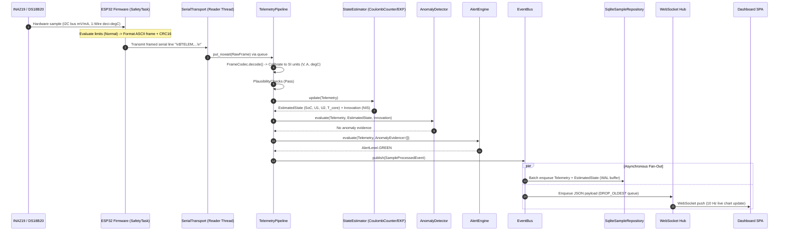
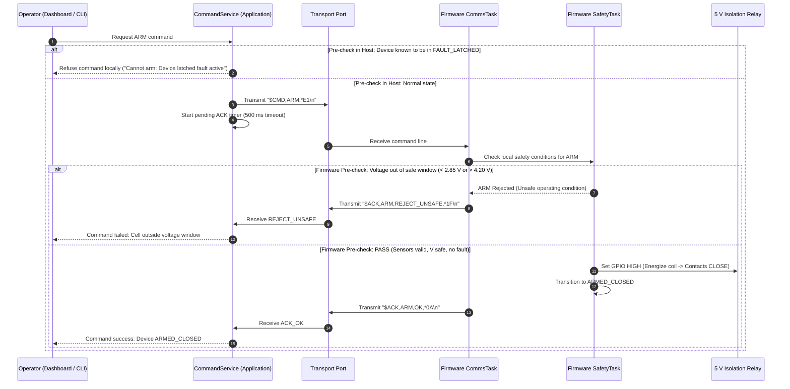
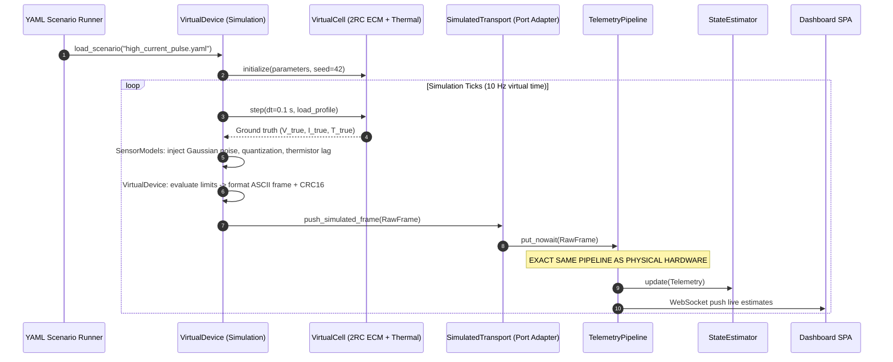

# Data Flow Sequences Architecture

Status: Draft for review
Last updated: 2026-10-26
Implements goals: G1, G2, G3, G4, G7
Implemented by: Prompt 03, Prompt 04, Prompt 07, Prompt 08, Prompt 09, Prompt 10, Prompt 11

## Purpose

This document specifies the primary operational sequences for HeatSense using formal sequence diagrams. It models communication flows across physical sensors, embedded firmware, host processing stages, persistence, and dashboard streaming under normal, faulted, and degraded conditions.

## Scope

This specification covers eight core runtime scenarios:
1. Normal sample telemetry acquisition and estimation.
2. Firmware autonomous fault trip and host advisory RED propagation.
3. Serial frame corruption recovery and decoder resynchronization.
4. Host disconnect and reconnection handling.
5. Advisory ARM / DISARM command dispatch and verification.
6. System startup and protocol handshake compatibility validation.
7. Session lifecycle and batched SQLite persistence.
8. Simulator-driven execution demonstrating hardware independence.

---

## Scenario A: Normal Sample Ingestion and State Estimation



### Narrative and Specification
1. **Trigger**: High-priority firmware `SafetyTask` timer ticks at 10 Hz.
2. **Preconditions**: ESP32 in `ARMED_CLOSED` or `IDLE_OPEN`; USB serial link established; host session active.
3. **Postconditions**: Telemetry sample persisted to SQLite; dashboard renders updated estimated SoC and live curves.
4. **Timing Expectations**: Total pipeline latency from sensor sample to dashboard render <= 150 ms (p50 PROVISIONAL; traces to `QA-P02`).
5. **Quality Attributes Served**: `QA-P01`, `QA-P02`, `QA-R04`, `QA-R05`.
6. **Failure Notes**: If the UI thread lags, the `DROP_OLDEST` queue policy drops websocket frames without stalling DB writes or serial ingestion.

---

## Scenario B: Firmware Autonomous Fault Trip Path

```mermaid
sequenceDiagram
    autonumber
    participant Sensor as INA219 (Voltage)
    participant FW_Safety as ESP32 SafetyTask (High Priority)
    participant Relay as 5 V Relay Coil (Actuator)
    participant FW_Comms as ESP32 CommsTask (Low Priority)
    participant HostPipe as Host TelemetryPipeline
    participant Alert as Host AlertEngine
    participant UI as Dashboard SPA

    Sensor->>FW_Safety: Voltage reading drops below UVP threshold (< 2.80 V)
    Note over FW_Safety: Debounce counter reaches 3 samples
    critical SAFETY PATH: Firmware Autonomous Protection
        FW_Safety->>Relay: Set GPIO LOW (De-energize coil)
        Relay-->>Relay: Contacts OPEN -> Load disconnected
        FW_Safety->>FW_Safety: Transition to FAULT_LATCHED (latch bit UVP)
    end
    Note over FW_Safety: Safety complete; Notify CommsTask
    FW_Safety->>FW_Comms: Queue telemetry update (state=FAULT_LATCHED, fault=0x0002)
    FW_Comms->>HostPipe: Serial frame "$TELEM,...,state=FAULT_LATCHED,fault=0x0002,*\n"
    HostPipe->>Alert: Telemetry.fault_mask indicates hardware UVP trip
    Alert->>Alert: Transition to AlertLevel.RED (Device-driven)
    Alert->>UI: WebSocket push Alert(Level.RED, "Battery protection active. Cell disconnected by the device.")
    Note over UI: UI displays red banner with exact claims-policy copy
```

### Narrative and Specification
1. **Trigger**: Shunt voltage reading falls below cut-off ($2.80$ V PROVISIONAL) under discharge load.
2. **Preconditions**: Device in `ARMED_CLOSED`; cell discharging ($I > 0$).
3. **Postconditions**: Relay physically open; ESP32 in `FAULT_LATCHED`; host displays `RED` advisory alert.
4. **Timing Expectations**: Relay contact disconnects within <= 100 ms of threshold crossing (PROVISIONAL; traces to `QA-S01`). Host notification occurs on next serial frame.
5. **Quality Attributes Served**: `QA-S01`, `QA-S04`, `QA-S05`, `QA-C01`.
6. **Failure Notes**: Zero host software components exist on the safety trip loop. Even if the laptop OS is frozen, the relay opens deterministically in hardware.

---

## Scenario C: Corrupted Serial Frame Recovery Path

```mermaid
sequenceDiagram
    autonumber
    participant FW as ESP32 Firmware
    participant Transport as SerialTransport (Reader Thread)
    participant Codec as FrameCodec (Domain Service)
    participant Pipe as TelemetryPipeline

    FW->>Transport: Electrical transient flips byte in stream ("$TELEX,1234,...*A3\n")
    Transport->>Codec: decode(RawFrame)
    Codec->>Codec: Crc16.verify() -> Checksum mismatch (Expected 0x9B12, got 0x00A3)
    Codec-->>Pipe: Result.Err(CrcMismatchError)
    Note over Pipe: Log CRC mismatch; increment error counter (crc_errors_count)
    Pipe->>Pipe: Drop corrupted frame; NO exception escapes pipeline
    FW->>Transport: Transmit next valid frame ("$TELEM,1244,4100,...*C4\n")
    Transport->>Codec: decode(RawFrame)
    Codec->>Codec: Checksum PASS -> Decodes valid Telemetry
    Codec-->>Pipe: Result.Ok(Telemetry)
    Pipe->>Pipe: Pipeline resumes normal processing
```

### Narrative and Specification
1. **Trigger**: Electrical noise, baud drift, or loose cable causes a bit flip or byte truncation on serial lines.
2. **Preconditions**: Serial transport open; telemetry streaming at 10 Hz.
3. **Postconditions**: Corrupted frame rejected; error metrics incremented; pipeline seamlessly resumes on next frame.
4. **Timing Expectations**: Resynchronization occurs within <= 1 frame period (PROVISIONAL; traces to `QA-R02`).
5. **Quality Attributes Served**: `QA-R01`, `QA-R02`, `QA-X02`.
6. **Failure Notes**: The decoder returns explicit Result types (`Ok`/`Err`) rather than raising unhandled exceptions.

---

## Scenario D: Host Disconnection and Reconnection Handling

```mermaid
sequenceDiagram
    autonumber
    participant FW as ESP32 Firmware
    participant Transport as SerialTransport
    participant Pipe as TelemetryPipeline
    participant Sess as SessionManager
    participant UI as Dashboard SPA

    Note over Transport: USB serial cable physically unplugged
    Transport->>Pipe: read_frame() raises SerialDisconnectException
    Pipe->>Transport: Transition to ConnectionState.RECONNECTING
    Pipe->>Sess: Record session communication gap (gap_start_s)
    Pipe->>UI: WebSocket broadcast ConnectionState.RECONNECTING
    Note over FW: ESP32 detects serial buffer full -> Drops comms frames\nESP32 CONTINUES AUTONOMOUS SAFETY MONITORING
    loop Exponential Backoff (0.5s, 1.0s, 2.0s...)
        Transport->>Transport: Attempt serial port re-open
    end
    Note over Transport: USB cable replugged; Port successfully opened
    Transport->>Transport: Transition to ConnectionState.CONNECTING
    FW->>Transport: Transmit HI1 greeting frame
    Transport->>Pipe: Validate HI1 protocol version match
    Pipe->>Transport: Transition to ConnectionState.CONNECTED
    Pipe->>Sess: Close communication gap; resume session recording
    Pipe->>UI: WebSocket broadcast ConnectionState.CONNECTED
```

### Narrative and Specification
1. **Trigger**: Physical USB cable disconnection or serial driver suspension.
2. **Preconditions**: Active streaming session in progress.
3. **Postconditions**: Host reconnects with backoff; session marks time gap; firmware operates continuously without reset.
4. **Timing Expectations**: Reconnect attempt begins at 500 ms backoff, caps at 10.0 s (PROVISIONAL; traces to `QA-R03`).
5. **Quality Attributes Served**: `QA-S04`, `QA-R03`, `QA-P04`.
6. **Failure Notes**: During disconnection, the ESP32 never blocks on serial writes; if buffer is full, it drops comms frames and continues executing `SafetyTask`.

---

## Scenario E: ARM / DISARM Command Path with Acknowledgements



### Narrative and Specification
1. **Trigger**: Operator clicks "ARM Cell" on dashboard or issues CLI disarm.
2. **Preconditions**: Device connected; host session running.
3. **Postconditions**: Firmware validates preconditions; relay actuated; acknowledgement returned or timeout reported.
4. **Timing Expectations**: Command round-trip acknowledgement within <= 100 ms (PROVISIONAL).
5. **Quality Attributes Served**: `QA-S04`, `QA-S05`, `QA-X01`.
6. **Failure Notes**: `DISARM` follows the identical path but has zero firmware guard conditions (it is unconditionally executed).

---

## Scenario F: Startup and Handshake Compatibility Validation

```mermaid
sequenceDiagram
    autonumber
    participant Host as bootstrap.py / IngestionService
    participant Transport as SerialTransport
    participant FW as ESP32 Firmware

    Host->>Transport: open() serial port (115200 baud)
    Transport->>Transport: Flush input/output serial buffers
    FW->>Transport: Emit boot handshake "$HI1,ver=1.0,proto=1,rate=10,limits=4250/2800/450/2000,*3D\n"
    Transport->>Host: RawFrame(HI1)
    Host->>Host: Protocol compatibility check (proto == SUPPORTED_PROTOCOL_VERSION)
    alt Protocol Version Mismatch
        Host->>Host: Raise IncompatibleProtocolVersionError; Halt startup
    else Protocol Version Compatible
        Host->>Host: Cache device reported firmware limits for diagnostic display
        Host->>Host: Initialize TelemetryPipeline and SessionManager
    end
```

### Narrative and Specification
1. **Trigger**: Host application launch or device connection.
2. **Preconditions**: Python environment initialized; serial port accessible.
3. **Postconditions**: Handshake confirmed; protocol compatibility verified; pipeline initialized.
4. **Timing Expectations**: Handshake completes within <= 1.0 s of serial open (PROVISIONAL).
5. **Quality Attributes Served**: `QA-M01`, `QA-T04`.
6. **Failure Notes**: If the firmware protocol version differs from the host version, the host halts immediately with a clear error rather than attempting to decode incompatible frames.

---

## Scenario G: Session Lifecycle and SQLite Persistence

```mermaid
sequenceDiagram
    autonumber
    participant UI as Dashboard / CLI
    participant Sess as SessionManager
    participant Pipe as TelemetryPipeline
    participant DB as SqliteSampleRepository
    participant File as SQLite File (WAL Mode)

    UI->>Sess: start_session(cell_model="Samsung-25R", mode=HARDWARE_LIVE)
    Sess->>DB: create_session(SessionMetadata)
    DB->>File: INSERT INTO sessions ... (BEGIN IMMEDIATE)
    Sess->>Pipe: activate_pipeline(session_id)
    loop Continuous Streaming (10 Hz)
        Pipe->>DB: enqueue_sample(Telemetry, EstimatedState)
        Note over DB: Buffer reaches batch size (e.g. 50 samples) OR 2.0 s timeout
        DB->>File: executemany(INSERT INTO samples ...) [WAL Write]
    end
    UI->>Sess: stop_session()
    Sess->>Pipe: deactivate_pipeline()
    Sess->>DB: flush_buffer()
    DB->>File: Commit remaining samples; UPDATE sessions SET end_time ...
    UI->>Sess: export_session_csv(session_id)
    Sess->>File: Read indexed session samples -> Generate CSV download
```

### Narrative and Specification
1. **Trigger**: Operator initiates experimental recording session.
2. **Preconditions**: Device connected or simulator scenario loaded.
3. **Postconditions**: Structured time-series records persisted to SQLite WAL database; exportable to CSV.
4. **Timing Expectations**: Batch write transaction executes every 5.0 seconds or 50 samples (PROVISIONAL; traces to `QA-P04`).
5. **Quality Attributes Served**: `QA-P03`, `QA-P04`, `QA-R05`.
6. **Failure Notes**: SQLite Write-Ahead Logging allows simultaneous non-blocking queries from the dashboard while background writes occur.

---

## Scenario H: Simulator Execution Path (Hardware Independence)



### Narrative and Specification
1. **Trigger**: Developer runs `heatsense sim run --scenario high_current_pulse.yaml`.
2. **Preconditions**: No physical hardware connected.
3. **Postconditions**: Pipeline processes virtual frames identically to physical hardware; proves hardware independence.
4. **Timing Expectations**: Real-time simulation runs at exactly 10 Hz; fast-forward mode runs as fast as CPU permits.
5. **Quality Attributes Served**: `QA-T03`, `QA-O01`.
6. **Failure Notes**: The `TelemetryPipeline` and downstream estimators have zero knowledge that data originates from a simulation; only `bootstrap.py` wires `SimulatedTransport`.

---

## Rules and Invariants

1. **Non-Blocking Critical Path**: No telemetry stage may execute synchronous network calls, slow disk flushes, or unbounded sleeps.
2. **Fault Prioritization**: Autonomous hardware safety trips supersede all host communications.
3. **Hardware Independence**: The identical pipeline code processes physical serial frames and simulated frames without conditional branches.

## Decisions Referenced

- [ADR-0003](../adr/0003-telemetry-transport-ascii-crc16.md): Telemetry transport format: ASCII framed lines with CRC16.
- [ADR-0004](../adr/0004-host-device-command-subset.md): Host-to-device commands limited to PING, ARM, DISARM, SET_RATE.
- [ADR-0005](../adr/0005-simulator-first-development.md): Simulator-first development methodology.
- [ADR-0006](../adr/0006-sqlite-wal-local-storage.md): Local storage in SQLite with WAL.
- [ADR-0007](../adr/0007-websocket-live-rest-history.md): Live data over WebSocket, history over REST.
- [ADR-0008](../adr/0008-dedicated-thread-serial-transport.md): Dedicated thread for serial reading bridged to asyncio.
- [ADR-0012](../adr/0012-alert-level-device-red-and-sensor-fault.md): Alert level semantics: RED device-only, SENSOR_FAULT precedence.

## Traceability

| Element | Implemented in Prompt | Verified by Which Test or Gate |
| :--- | :--- | :--- |
| Scenario A (Normal Flow) | Prompt 07, Prompt 08 | End-to-end integration test (`host/tests/integration/`) |
| Scenario B (Safety Trip Flow) | Prompt 11, Prompt 12 | Hardware trip bench test & integration test |
| Scenario C (Corruption Flow) | Prompt 04 | Property-based fuzzer (`host/tests/property/`) |
| Scenario D (Reconnect Flow) | Prompt 08 | Serial reconnect integration test |
| Scenario E (Command Flow) | Prompt 04, Prompt 07 | Command service unit and contract tests |
| Scenario F (Handshake Flow) | Prompt 04, Prompt 08 | Handshake negotiation unit test |
| Scenario G (Session Flow) | Prompt 07, Prompt 08 | Session repository integration test |
| Scenario H (Simulator Flow) | Prompt 06 | Simulator determinism regression test |

## Open Questions

- `OQ-002`: Firmware-enforced maximum ARMED discharge duration timeout (Owner: Embedded Engineer / Systems Engineer, Blocks: Prompt 11).
- `OQ-005`: Serial baud rate and buffer sizing at 10 Hz telemetry (Owner: Embedded Engineer / Systems Engineer, Blocks: Prompt 04).
