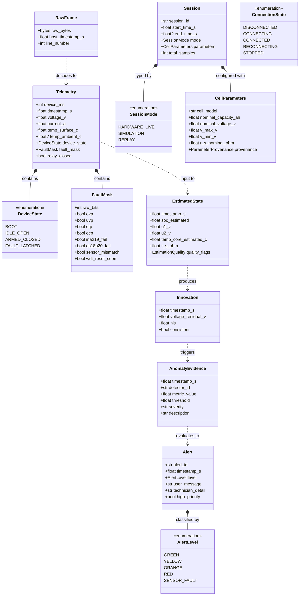

# Domain Model Architecture

Status: Draft for review
Last updated: 2026-10-26
Implements goals: G1, G3, G4, G7
Implemented by: Prompt 03, Prompt 04, Prompt 05, Prompt 07

## Purpose

This document defines the pure domain model, entities, value objects, enumeration types, mathematical conversions, and plausibility rules for HeatSense. The domain layer encapsulates all battery physics concepts and is strictly decoupled from frameworks, transport mechanisms, and persistence storage.

## Scope

This specification covers:
1. Core domain entities and value objects.
2. Wire-to-domain unit conversions and boundary transformations.
3. Firmware fault-mask bit definitions.
4. Physical plausibility checks and quality flag models.
5. Cell parameter provenance classifications.

## Domain Model Diagram

### Domain Model Element Descriptions

| Class Name | Type | Responsibility in System |
| :--- | :--- | :--- |
| **`RawFrame`** | Value Object | Immutable container for an undecoded wire payload, captured receive timestamp, and diagnostic line count. |
| **`Telemetry`** | Entity | Fully decoded, calibrated, and validated physical sample represented in SI units. |
| **`DeviceState`** | Enum | Discrete microcontroller operational state mirrored from firmware wire frames. |
| **`FaultMask`** | Value Object | Strongly-typed bitfield wrapper extracting individual hardware safety trip flags. |
| **`EstimatedState`** | Entity | Hidden physical state estimations produced by estimators (estimated SoC, polarizations, estimated uncalibrated core temperature). |
| **`Innovation`** | Value Object | Kalman filter voltage residual and Normalized Innovation Squared (NIS) statistical metric. |
| **`AnomalyEvidence`** | Value Object | Diagnostic record of a statistical or physical deviation generated by an anomaly detector. |
| **`AlertLevel`** | Enum | Standardized five-level advisory alert classification (`GREEN`, `YELLOW`, `ORANGE`, `RED`, `SENSOR_FAULT`). |
| **`Alert`** | Entity | Active advisory notification containing verified operator copy and technical diagnostic details. |
| **`Session`** | Entity | Root aggregate representing a contiguous continuous recording run of battery operation. |
| **`SessionMode`** | Enum | Operational source type (`HARDWARE_LIVE`, `SIMULATION`, `REPLAY`). |
| **`CellParameters`** | Entity | Provenance-tracked physical battery specifications and model parameters. |
| **`ConnectionState`** | Enum | State of the host transport adapter connection to the hardware device or simulator. |

## Data Types, Ranges, and Invariants

| Class / Field | Type | Domain Unit | Valid Physical Range (PROVISIONAL) | Validation Rule | Action on Violation |
| :--- | :--- | :--- | :--- | :--- | :--- |
| `Telemetry.timestamp_s` | `float` | Seconds ($s$) | $> 0$, strictly monotonic | $\Delta t > 0$ relative to previous sample | Flag `NON_MONOTONIC_TIME`; drop frame |
| `Telemetry.voltage_v` | `float` | Volts ($V$) | $0.0$ to $5.0$ V | Plausibility window ($2.0 \le V \le 4.5$ V) | Flag `VOLTAGE_OUT_OF_BOUNDS`; retain sample |
| `Telemetry.current_a` | `float` | Amperes ($A$) | $-1.0$ to $+5.0$ A | Sign: $I > 0$ is DISCHARGE; $|I| \le 3.0$ A | Flag `CURRENT_OUT_OF_BOUNDS`; retain sample |
| `Telemetry.temp_surface_c` | `float` | Celsius ($^\circ\text{C}$) | $-10.0$ to $+70.0\,^\circ\text{C}$ | Reject disconnected sentinel; plausible rate | Flag `SURFACE_TEMP_INVALID`; suppress alert |
| `EstimatedState.soc_estimated`| `float` | Fraction ($0..1$)| $0.00$ to $1.00$ | Physical bounding $[0.0, 1.0]$ | Clip to $[0, 1]$; flag `SOC_SATURATED` |
| `EstimatedState.u1_v` | `float` | Volts ($V$) | $-0.5$ to $+0.5$ V | Diffusion polarization decay stability | Flag `POLARIZATION_DIVERGENCE` |
| `EstimatedState.u2_v` | `float` | Volts ($V$) | $-0.5$ to $+0.5$ V | Slow diffusion polarization stability | Flag `POLARIZATION_DIVERGENCE` |
| `EstimatedState.temp_core_estimated_c` | `float` | Celsius ($^\circ\text{C}$) | $-10.0$ to $+90.0\,^\circ\text{C}$ | Must be $\ge$ surface temp during discharge | Flag `THERMAL_MODEL_UNSTABLE` |
| `Innovation.nis` | `float` | Dimensionless | $\ge 0.0$ | Chi-square 95% confidence check ($\le 3.84$) | Trigger `INNOVATION_OUTLIER` evidence |

## Wire-to-Domain Mapping

The transformation of wire units to domain SI units occurs at exactly **ONE** location in the host architecture: within the `TelemetryPipeline` decoding and conversion stage (`heatsense.domain.services.FrameCodec`). No downstream domain service, application use case, or UI adapter ever touches raw wire units.

| Wire Field | Wire Unit / Format | Domain Field | Domain Unit | Conversion Formula | Handling of Invalid / Missing |
| :--- | :--- | :--- | :--- | :--- | :--- |
| `device_ms` | `uint32` ms | `timestamp_s` | Seconds ($s$) | `DeviceTimeUnwrapper.unwrap(device_ms) / 1000.0` | Detects and corrects for 49.7-day uint32 rollover |
| `v_mv` | `int32` millivolts | `voltage_v` | Volts ($V$) | `v_mv / 1000.0` | Frame rejected if wire string cannot parse to integer |
| `i_ma` | `int32` milliamps | `current_a` | Amperes ($A$) | `i_ma / 1000.0` | **$I > 0$ denotes DISCHARGE**. Positive indicates discharge. |
| `t_dc` | `int16` deci-Celsius | `temp_surface_c` | Celsius ($^\circ\text{C}$) | `t_dc / 10.0` | Wire sentinel `-999` maps strictly to `None` |
| `flags` | `uint16` hex bitmask| `fault_mask` | `FaultMask` | `FaultMask.from_bits(flags)` | Extracted into strongly-typed boolean attributes |
| `state` | `uint8` enum ID | `device_state` | `DeviceState` | `DeviceState(state)` | Unmapped integer maps to `DeviceState.BOOT` error |

## FaultMask Bit Allocation

The `FaultMask` encodes discrete hardware safety trip conditions and sensor fault diagnostics. The authoritative byte layout and bit assignments were formally established in `docs/protocol/telemetry-v1.md` (Prompt 04).

| Bit Position | Mnemonic | Semantic Meaning | Hardware Source | Safety Trip Triggered? |
| :--- | :--- | :--- | :--- | :--- |
| **Bit 0** | `OVP` | Over-Voltage Protection trip ($V > 4.25$ V) | INA219 bus voltage register | **YES** (Autonomous firmware trip) |
| **Bit 1** | `UVP` | Under-Voltage Protection trip ($V < 2.80$ V) | INA219 bus voltage register | **YES** (Autonomous firmware trip) |
| **Bit 2** | `OTP` | Over-Temperature Protection trip ($T > 45.0\,^\circ\text{C}$) | DS18B20 maximum probe reading | **YES** (Autonomous firmware trip) |
| **Bit 3** | `OCP` | Over-Current Protection trip ($I > 2.0$ A discharge) | INA219 shunt current calculation | **YES** (Autonomous firmware trip) |
| **Bit 4** | `INA219_FAIL` | INA219 communication error or I2C bus lockup | I2C transaction timeout / NACK | **YES** (Failsafe timeout trip) |
| **Bit 5** | `DS18B20_FAIL`| 1-Wire communication error or disconnected probe | 1-Wire CRC error or missing probe | **YES** (Failsafe timeout trip) |
| **Bit 6** | `SENSOR_MISMATCH`| Probe gradient exceeds maximum plausible spread | $\Delta T_{\text{probes}} > 5.0\,^\circ\text{C}$ difference | **YES** (Pre-check or runtime trip) |
| **Bit 7** | `WDT_RESET_SEEN`| Watchdog timer reset occurred on previous boot | ESP32 reset reason registers | **NO** (Diagnostic advisory flag) |

## Physical Plausibility Rules

Plausibility checks evaluate incoming physical measurements against physical battery laws. **Crucial Rule**: Plausibility checks generate `AnomalyEvidence` or set quality flags; they **NEVER** silently discard or delete telemetry samples.

1. **Voltage Bounds**: Cell terminal potential must remain within $2.0 \text{ V} \le V \le 4.5 \text{ V}$ during active operation. Values outside this window indicate sensor failure or extreme cell damage.
2. **Current Bounds**: Load discharge current must satisfy $-0.1 \text{ A} \le I \le 2.5 \text{ A}$ under the 10 ohm load. Values $> 2.5$ A indicate load short-circuit; negative values indicate reversed wiring or active charging.
3. **Slew Rate Limits (PROVISIONAL)**:
   - Maximum $\frac{dV}{dt} \le 1.0 \text{ V/s}$ during continuous discharge (excluding instantaneous ohmic step jumps upon relay switching).
   - Maximum $\frac{dT}{dt} \le 0.5\,^\circ\text{C/s}$ under passive convection cooling.
4. **Stale Data Detection**: If consecutive samples report identical voltage and current down to the least significant bit for $> 5$ consecutive seconds while ARMED, the pipeline flags `STALE_SENSOR_DATA`.

## Estimation Quality Flags

State estimators publish explicit `EstimationQuality` flags with every computed estimate:
- `INITIALIZING`: Estimator is populating covariance matrices; estimates are unconverged.
- `CONVERGED`: Estimator residuals and covariance metrics are within steady-state confidence bounds.
- `DROPOUT`: Telemetry frames were dropped; state propagated via open-loop prediction.
- `DIVERGED`: NIS residual persistently violates 99% Chi-square bounds; state corrections rejected.
- `PARAMETERS_PROVISIONAL`: Physical parameters used for estimation are uncalibrated engineering generic values.

The dashboard displays these flags adjacent to every numeric estimate to prevent misleading operators.

## Parameter Provenance Model

Every instance of `CellParameters` carries a mandatory provenance tag:
1. `PROVISIONAL_GENERIC`: Literature values or unverified manufacturer datasheet numbers.
2. `MEASURED_FIT`: Parameters derived from bench identification experiments on this specific cell batch.
3. `VALIDATED`: Parameters verified against multi-cycle laboratory characterization data.

Nothing in HeatSense may display or export parameters without showing their provenance level.

## Rules and Invariants

1. **Pure Domain Isolation**: Domain classes and value objects must contain zero I/O code, zero external library imports (NumPy only), and zero knowledge of serialization wire formats.
2. **Immutability of Samples**: Telemetry samples and raw frames are immutable once created.
3. **SI Consistency**: All internal calculations, models, and interfaces express physical quantities strictly in SI units ($V$, $A$, $\Omega$, $F$, $^\circ\text{C}$, $s$).

## Decisions Referenced

- [ADR-0001](../adr/0001-repository-layout.md): Monorepo layout with sibling safety boundaries and hexagonal host.
- [ADR-0003](../adr/0003-telemetry-transport-ascii-crc16.md): Telemetry transport format: ASCII framed lines with CRC16.
- [ADR-0012](../adr/0012-alert-level-device-red-and-sensor-fault.md): Alert level semantics: RED device-only, SENSOR_FAULT precedence.
- [ADR-0013](../adr/0013-estimator-strategy-and-coulomb-counter.md): State estimator strategy pattern.
- [ADR-0015](../adr/0015-parameter-provenance-status-labels.md): Explicit parameter provenance and status labels.

## Traceability

| Element | Implemented in Prompt | Verified by Which Test or Gate |
| :--- | :--- | :--- |
| Domain Value Objects & Entities | Prompt 05 | Domain unit test suite (`host/tests/unit/domain/`) |
| Wire-to-Domain Decoders | Prompt 04, Prompt 05 | Golden frame tests (`contracts/golden/`) |
| FaultMask Bitfield | Prompt 04, Prompt 05 | Bitwise property-based tests (`host/tests/property/`) |
| Plausibility Evaluators | Prompt 05 | Edge-case unit test scenarios |
| Parameter Provenance | Prompt 05, Prompt 09 | Configuration loading tests and DTO schema validation |

## Open Questions

- `OQ-003`: Confirmed cell safety limits and formal sign-off procedure (Owner: Hardware Teammate / Human, Blocks: Prompt 05).
- `OQ-006`: Is ambient temperature measured via dedicated sensor or configured as a constant? (Owner: Hardware Teammate, Blocks: Prompt 04).
