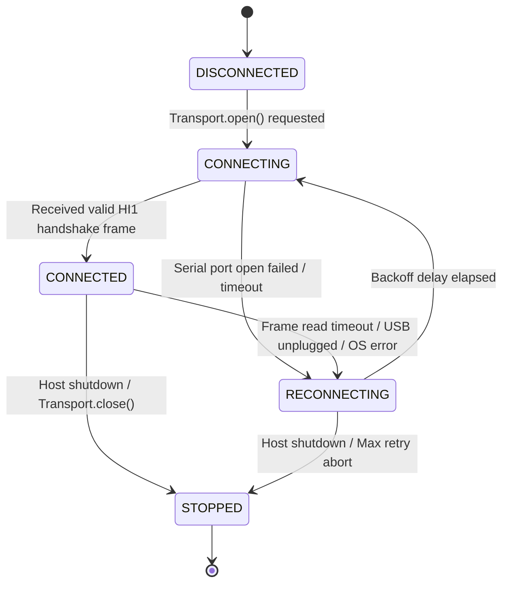
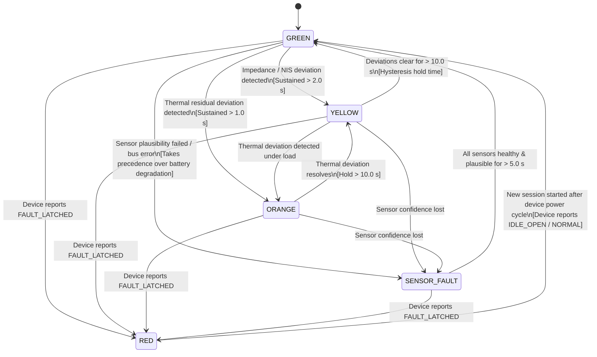

# State Machines Architecture

Status: Draft for review
Last updated: 2026-10-26
Implements goals: G1, G2, G3, G7
Implemented by: Prompt 03, Prompt 05, Prompt 07, Prompt 08, Prompt 11

## Purpose

This document defines the formal finite state machines governing HeatSense:
1. The **Device State Machine** executing autonomously within the ESP32 firmware.
2. The **Host Connection State Machine** managing the lifecycle of the serial transport.
3. The **Host Advisory Alert State Machine** classifying battery precursor deviations into five strictly defined operational alert levels.

## Scope

This specification covers discrete states, transitions, guard conditions, entry/exit actions, hysteresis timing, and user-facing copy. It applies to firmware runtime behavior, host transport handling, and advisory alert evaluation.

---

## 1. Device State Machine (Firmware)

The Device State Machine runs inside the ESP32 firmware and is the sole authoritative controller of the physical 5 V load isolation relay.

```mermaid
stateDiagram-v2
    [*] --> BOOT : Power-on / Hardware Reset

    BOOT --> IDLE_OPEN : Boot self-check PASS\n[Sensors valid, limits safe]
    BOOT --> FAULT_LATCHED : Boot self-check FAIL\n[Bus error / limit violated]

    IDLE_OPEN --> ARMED_CLOSED : Host CMD_ARM\n[Guard: No fault, V in window, sensors valid]
    IDLE_OPEN --> FAULT_LATCHED : Limit Violated in Idle\n[OVP / UVP / OTP / Sensor fail]

    ARMED_CLOSED --> IDLE_OPEN : Host CMD_DISARM\n[Always permitted]
    ARMED_CLOSED --> FAULT_LATCHED : SAFETY PATH: Safety Limit Tripped\n[OVP / UVP / OTP / OCP / Sensor timeout]

    FAULT_LATCHED --> BOOT : Power Cycle / Hardware Reboot\n(PROVISIONAL: OQ-001)

    %% Relay State Note
    note right of BOOT : Relay: OPEN (unpowered)
    note right of IDLE_OPEN : Relay: OPEN (isolated)
    note right of ARMED_CLOSED : Relay: CLOSED (discharging)
    note right of FAULT_LATCHED : Relay: OPEN (latched disconnect)
```

### Relay Actuator State per Device State

| Device State | Relay Contact Position | Coil Drive Signal | Physical Load State |
| :--- | :--- | :--- | :--- |
| `BOOT` | **OPEN** | De-energized (Low) | Load resistor completely disconnected |
| `IDLE_OPEN` | **OPEN** | De-energized (Low) | Load resistor completely disconnected |
| `ARMED_CLOSED` | **CLOSED** | Energized (High) | Load resistor connected; discharge current flows ($I > 0$) |
| `FAULT_LATCHED` | **OPEN** | De-energized (Low) | Load resistor latched open; discharge interrupted |

### Device Transition Table

| Current State | Trigger Event | Guard Condition | Executed Action | Next State |
| :--- | :--- | :--- | :--- | :--- |
| `BOOT` | Self-check complete | All sensors respond; voltage within $[2.80, 4.25]$ V; no watchdog fault | Emit `HI1` greeting frame; set relay GPIO low | `IDLE_OPEN` |
| `BOOT` | Self-check failed | I2C/1-Wire timeout; voltage out of bounds; watchdog flag set | Set fault mask bit; de-energize relay; emit fault frame | `FAULT_LATCHED` |
| `IDLE_OPEN` | Received `CMD_ARM` | `fault_mask == 0` AND $2.85 \text{ V} \le V \le 4.20 \text{ V}$ AND sensors fresh | Energize relay coil; emit `ACK_ARM` | `ARMED_CLOSED` |
| `IDLE_OPEN` | Received `CMD_ARM` | Guard condition NOT met (voltage out of window or sensor error) | Retain open relay; emit `REJECT_ARM_UNSAFE` | `IDLE_OPEN` |
| `IDLE_OPEN` | Sensor limit violation | $V, T$ exceeds threshold or sensor fails for $> 500$ ms | Latch fault bit; emit fault frame | `FAULT_LATCHED` |
| `ARMED_CLOSED`| Received `CMD_DISARM` | None (Disarm is unconditionally honoured) | De-energize relay coil; emit `ACK_DISARM` | `IDLE_OPEN` |
| `ARMED_CLOSED`| Safety limit violated | Measured $V, I, T$ violates safety threshold for $> 3$ consecutive samples | **SAFETY PATH**: De-energize relay coil immediately; latch fault bit | `FAULT_LATCHED` |
| `ARMED_CLOSED`| Sensor communication loss | INA219 or DS18B20 fails to respond for $> 500$ ms | **SAFETY PATH**: De-energize relay coil immediately; latch `SENSOR_FAIL` bit | `FAULT_LATCHED` |
| `ARMED_CLOSED`| Watchdog trigger | Firmware safety task misses deadline ($> 200$ ms) | Microcontroller hardware reset; relay de-energizes | `BOOT` |
| `FAULT_LATCHED`| Received any command | Any host command (`ARM`, `DISARM`, `SET_RATE`) | Reject command; emit `REJECT_FAULT_LATCHED` | `FAULT_LATCHED` |
| `FAULT_LATCHED`| Physical power cycle | Hard power removal and re-application | Hardware resets registers; initiates boot sequence | `BOOT` |

---

## 2. Host Connection State Machine

The Host Connection State Machine executes in the host application infrastructure layer (`heatsense.infrastructure.transport`) to maintain communication over the USB serial interface.



### Backoff Parameters (PROVISIONAL)

| Parameter Name | Provisional Value | Rationale | Verification Experiment |
| :--- | :--- | :--- | :--- |
| `INITIAL_RECONNECT_DELAY_S` | `0.5` seconds | Rapid initial reconnection attempt for transient USB glitches | Serial cable unplug/replug bench test |
| `BACKOFF_MULTIPLIER` | `2.0` | Exponentially decrease USB polling overhead during sustained disconnect | Measure host CPU during unplugged state |
| `MAX_RECONNECT_DELAY_S` | `10.0` seconds | Bounded upper limit preventing indefinitely long wait states | Verify reconnection occurs within 10 s after replug |
| `RECONNECT_JITTER_RATIO` | `0.2` (+/- 20%) | Prevents lockstep timing conflicts across concurrent tasks | Synthetic jitter unit test |

---

## 3. Host Advisory Alert State Machine

The Alert State Machine executes inside the host `AlertEngine` (`heatsense.application.alerts`). It translates physical state innovations and sensor health metrics into standardized advisory levels.



### Advisory Alert Level Specification

| Alert Level | Meaning & Semantic Boundary | Entry Condition | Exit Condition | High Priority Event? |
| :--- | :--- | :--- | :--- | :--- |
| **`GREEN`** | Normal monitoring. No configured safety or advisory threshold violated. | Default initial state; or all anomaly evidence cleared for $> 10.0$ s. | Any persistent anomaly evidence detected; or device reports fault. | No |
| **`YELLOW`** | Electrochemical deviation. Polarization or impedance precursor anomaly detected. | Innovation NIS $> 3.84$ or estimated $R_s$ growth $> 20\%$ sustained for $\ge 2.0$ s. | Residuals return below threshold for $> 10.0$ s; or escalated to `ORANGE`/`RED`. | No |
| **`ORANGE`** | Thermal precursor anomaly. Heating rate or temperature gradient exceeds expected model. | Surface temperature residual $\Delta T > 2.5\,^\circ\text{C}$ or $\frac{dT}{dt} > 0.3\,^\circ\text{C/s}$ for $\ge 1.0$ s. | Temperature residuals return within bounds for $> 10.0$ s. | **YES** |
| **`RED`** | **CRITICAL HARDWARE TRIP**. Device opened relay due to safety limit violation. | **DEVICE-DRIVEN ONLY**: Incoming telemetry frame contains `device_state == FAULT_LATCHED` or non-zero safety trip bit. | Device reboots and streams non-fault state (`IDLE_OPEN`) in a new session. | **YES** |
| **`SENSOR_FAULT`**| Sensor data invalid or degraded. Does NOT indicate a cell fault. | DS18B20 disconnected sentinel (`-999`), INA219 bus timeout, or gradient $> 5.0\,^\circ\text{C}$. | All sensors report physically plausible values continuously for $\ge 5.0$ s. | **YES** |

### Verified User-Facing Copy

To comply strictly with `docs/claims-policy.md`, the dashboard and host notifications display the exact strings below without alteration:

| Alert Level | Exact User-Facing Copy (`user_message`) | Technician Diagnostic Copy (`technician_detail`) |
| :--- | :--- | :--- |
| **`GREEN`** | `"Battery status: normal monitoring"` | `"All sensor metrics, innovations, and thermal residuals within configured thresholds."` |
| **`YELLOW`** | `"Battery health needs attention. Schedule a check."` | `"Precursor impedance deviation detected: Kalman filter voltage innovation NIS exceeded confidence bound."` |
| **`ORANGE`** | `"Battery heating is unusual for the current load. Reduce load; stop if the warning continues."` | `"Thermal precursor deviation detected: Two-node thermal model surface temperature residual exceeds expected boundary."` |
| **`RED`** | `"Battery protection active. Cell disconnected by the device."` | `"Firmware latched safety trip: Microcontroller opened relay due to hardware limit violation."` |
| **`SENSOR_FAULT`**| `"Battery sensor issue. Service required."` | `"Sensor communication failure or plausibility violation detected. Battery state estimation suspended."` |

### Alert Hysteresis and Precedence Rules

1. **Device Sole Authority for `RED`**: No software estimator, machine learning model, or anomaly detector running on the host may emit `RED`. The host transitions to `RED` if and only if the ESP32 firmware transmits a frame reporting `FAULT_LATCHED` or a hardware trip bit.
2. **`SENSOR_FAULT` Precedence**: If any sensor reading is missing, corrupt, or implausible, the alert engine enters `SENSOR_FAULT`. This suppresses false `YELLOW` or `ORANGE` alerts that might arise from feeding bad sensor data into the Kalman filter or thermal model.
3. **Asymmetric Escalation Hysteresis**:
   - **Escalation Dwell Time (Fast)**: $1.0$ to $2.0$ seconds (PROVISIONAL). Ensures prompt operator awareness of genuine physical trends.
   - **De-escalation Hold Time (Slow)**: $10.0$ seconds (PROVISIONAL). Prevents alert flickering and banner flashing across noisy boundary thresholds.

## Rules and Invariants

1. **Unconditional Disarm**: In the Device State Machine, transition from `ARMED_CLOSED` to `IDLE_OPEN` via `CMD_DISARM` is unconditional and possesses no blocking guard conditions.
2. **Latched Fault Isolation**: A latched fault in firmware cannot be cleared by software commands. It requires a physical power cycle (`OQ-001`).
3. **No Advisory Blindness**: Sensor faults must never be diagnosed as battery electrochemical failures.

## Decisions Referenced

- [ADR-0004](../adr/0004-host-device-command-subset.md): Host-to-device commands limited to PING, ARM, DISARM, SET_RATE.
- [ADR-0008](../adr/0008-dedicated-thread-serial-transport.md): Dedicated thread for serial reading bridged to asyncio.
- [ADR-0011](../adr/0011-firmware-dual-task-concurrency.md): Firmware concurrency: SafetyTask and CommsTask.
- [ADR-0012](../adr/0012-alert-level-device-red-and-sensor-fault.md): Alert level semantics: RED device-only, SENSOR_FAULT precedence.

## Traceability

| Element | Implemented in Prompt | Verified by Which Test or Gate |
| :--- | :--- | :--- |
| Firmware Device State Machine | Prompt 11 | Embedded Unity native unit tests (`firmware/test/`) |
| Host Transport Reconnect Logic | Prompt 08 | Serial transport mock reconnect integration test |
| Host Alert Level State Machine | Prompt 07 | Alert engine unit tests (`host/tests/unit/application/`) |
| Exact User Copy Claims Check | Prompt 02, Prompt 03 | Automated claims scanner in `scripts/verify_structure.py` |

## Open Questions

- `OQ-001`: Latched fault clearing mechanism: Is power cycling acceptable or is a physical reset button required? (Owner: Hardware Teammate / Human, Blocks: Prompt 11).
- `OQ-002`: Firmware-enforced maximum ARMED discharge duration timeout (Owner: Embedded Engineer / Systems Engineer, Blocks: Prompt 11).
