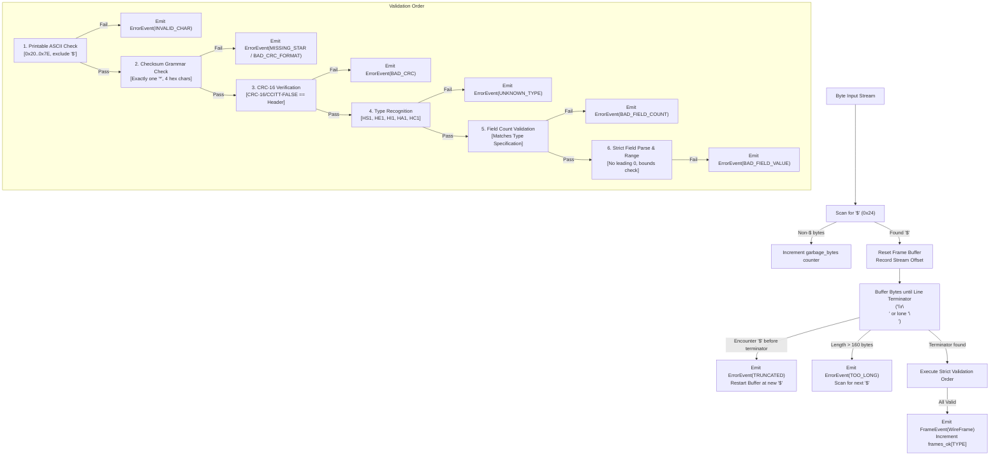

# HeatSense Telemetry Protocol Specification v1

Status: Draft for review
Last updated: 2026-10-26

## 1. Purpose, Scope, and Status

### 1.1 Purpose
This document specifies the authoritative, byte-exact serial wire telemetry protocol (version 1) connecting the ESP32 microcontroller firmware and the Python host application for the HeatSense single-cell battery digital twin.

### 1.2 Scope
This specification defines:
- ASCII framing format, delimiters, character sets, and CRC-16 checksum algorithm.
- Exact field ordering, integer encodings, numeric bounds, and sentinel representations.
- Device state codes, fault bitmask mappings, event codes, and command acknowledgement codes.
- Host-to-device command semantics and non-negotiable hardware safety boundaries.
- Streaming decoder behavior, error classification, resynchronization rules, and resource bounds.
- Shared golden test vector formats for cross-language validation in Python and C++.

This specification does **NOT** define physical state estimation models (2RC ECM, EKF), thermal equations, SQLite database schemas, or web presentation protocols.

### 1.3 Document Status
This document is **Draft for review**. Per repository governance, only a human reviewer may promote this specification to `Frozen` upon formal sign-off at the quality gate.

---

## 2. Terminology and Conventions

### 2.1 RFC 2119 Key Words
The key words **MUST**, **MUST NOT**, **REQUIRED**, **SHALL**, **SHALL NOT**, **SHOULD**, **SHOULD NOT**, **RECOMMENDED**, **MAY**, and **OPTIONAL** in this document are to be interpreted as described in RFC 2119.

### 2.2 Wire Units and Sign Conventions
- **Current Sign Convention**: Current $I > 0$ **MUST** represent **DISCHARGE** (current flowing out of the 18650 cell into the load resistor). Negative current ($I < 0$) represents charging.
- **Wire Units**: All physical quantities on the wire **MUST** be serialized strictly as integer representations of fixed sub-multiples:
  - Voltage: Millivolts (`v_mv`, integer mV; e.g., $4150 = 4.150\text{ V}$).
  - Current: Milliamperes (`i_ma`, integer mA; e.g., $420 = 0.420\text{ A}$).
  - Surface Temperature: Deci-Celsius (`t_dc`, integer $0.1\,^\circ\text{C}$; e.g., $245 = 24.5\,^\circ\text{C}$).
  - Device Time: Milliseconds (`t_ms`, integer ms since boot).
  - Frequency: Hertz (`rate_hz`, integer Hz).

---

## 3. Physical Layer Settings (PROVISIONAL)

The protocol executes over an asynchronous USB virtual serial COM port (CDC-ACM).

| Parameter | Specification | Status | Notes |
| :--- | :--- | :--- | :--- |
| **Baud Rate** | 115200 bps | PROVISIONAL | Standard USB-to-UART bridge rate (see `OQ-005`) |
| **Data Bits** | 8 | PROVISIONAL | 8 data bits per word |
| **Parity** | None | PROVISIONAL | Parity check disabled |
| **Stop Bits** | 1 | PROVISIONAL | Standard 1 stop bit |
| **Flow Control** | None | PROVISIONAL | Software/hardware handshaking disabled |
| **Physical Encoding** | 8N1 (10 wire bits/byte)| PROVISIONAL | 1 start bit + 8 data bits + 1 stop bit |

---

## 4. Frame Layout and Annotated Examples

### 4.1 General Grammar
Every frame **MUST** conform to the following ASCII layout:
```text
$<TYPE>,<field1>,<field2>,...,<fieldN>*<CRC>\r\n
```

1. **Start Delimiter**: Exactly one ASCII dollar sign `$` (`0x24`).
2. **Type Identifier (`<TYPE>`)**: Exactly three uppercase alphanumeric ASCII characters matching `^[A-Z]{2}[0-9]$` (e.g. `HS1`, `HE1`, `HI1`, `HA1`, `HC1`).
3. **Field Separator**: ASCII comma `,` (`0x2C`). No whitespace (spaces, tabs) is permitted anywhere in the frame.
4. **Checksum Delimiter**: Exactly one ASCII asterisk `*` (`0x2A`) separating the frame body from the checksum.
5. **Checksum (`<CRC>`)**: Exactly four uppercase hexadecimal ASCII characters (`0-9`, `A-F`). Lowercase characters `a-f` **MUST** be rejected as `BAD_CRC_FORMAT`.
6. **Line Termination**:
   - The encoder **MUST** emit Carriage Return followed by Line Feed (`\r\n`, `0x0D 0x0A`).
   - The decoder **MUST** accept both `\r\n` and lone `\n` (`0x0A`), counting lone `\n` line endings separately.
7. **Maximum Frame Length**: A frame **MUST NOT** exceed **160 bytes**, inclusive of the leading `$` and trailing termination bytes. Frames exceeding 160 bytes **MUST** be rejected with `TOO_LONG`.
8. **Allowed Character Set**: Bytes between `$` and the line terminator **MUST** be printable ASCII characters in the range `0x20` to `0x7E`, excluding `$`. Characters outside this range **MUST** trigger `INVALID_CHAR`.
9. **Resynchronization**: If a `$` is encountered while buffering an uncompleted frame, the buffered partial frame **MUST** be aborted as `TRUNCATED`, and parsing **MUST** restart with the new `$`.

### 4.2 Checksum Algorithm (CRC-16/CCITT-FALSE)
The checksum **MUST** be computed using CRC-16/CCITT-FALSE:
- **Polynomial**: `0x1021` ($x^{16} + x^{12} + x^5 + 1$).
- **Initial Value**: `0xFFFF`.
- **Reflect Input**: False (MSB first).
- **Reflect Output**: False.
- **Final XOR**: `0x0000`.
- **Coverage**: Strictly the ASCII bytes between `$` and `*` (exclusive). The leading `$` and trailing `*` are **NOT** included in the CRC calculation.
- **Required Check Value**: The CRC of ASCII string `"123456789"` (`0x31 0x32 ... 0x39`) **MUST** equal `0x29B1`.

### 4.3 Annotated Frame Examples

#### HS1: Telemetry Sample
```text
$HS1,1,100,4150,420,245,248,242,2,0*BB31\r\n
```
- **Byte Breakdown**:
  - `$` (`0x24`): Frame start.
  - `HS1,1,100,4150,420,245,248,242,2,0` (34 bytes): CRC input payload.
    - `HS1`: Type identifier (Telemetry v1).
    - `1`: Sequence counter (`seq = 1`).
    - `100`: Timestamp (`t_ms = 100` ms).
    - `4150`: Voltage (`v_mv = 4150` mV = 4.150 V).
    - `420`: Current (`i_ma = 420` mA = 0.420 A discharge).
    - `245`: Surface Probe 1 (`t1_dc = 245` = 24.5 °C).
    - `248`: Surface Probe 2 (`t2_dc = 248` = 24.8 °C).
    - `242`: Surface Probe 3 (`t3_dc = 242` = 24.2 °C).
    - `2`: Device state (`state = 2`, ARMED_CLOSED).
    - `0`: Fault mask (`faults = 0x0000`, normal).
  - `*` (`0x2A`): Checksum delimiter.
  - `BB31`: CRC-16 checksum (`0xBB31`).
  - `\r\n` (`0x0D 0x0A`): Line terminator.

#### HE1: Device Event
```text
$HE1,1,100,1,0*1B5B\r\n
```
- **CRC Input**: `HE1,1,100,1,0` (13 bytes) $\rightarrow$ CRC `0x1B5B`.
- **Fields**: `seq = 1`, `t_ms = 100`, `event = 1` (`ARM_OK`), `detail = 0`.

#### HI1: Device Information / Handshake
```text
$HI1,v1.0.0,4250,2800,450,2000,10,0*C75B\r\n
```
- **CRC Input**: `HI1,v1.0.0,4250,2800,450,2000,10,0` (34 bytes) $\rightarrow$ CRC `0xC75B`.
- **Fields**: `fw = "v1.0.0"`, `ovp_mv = 4250` mV, `uvp_mv = 2800` mV, `otp_dc = 450` (45.0 °C), `ocp_ma = 2000` mA, `rate_hz = 10` Hz, `test_limits = 0` (production limits active).

#### HA1: Command Acknowledgement
```text
$HA1,1,0*C9B1\r\n
```
- **CRC Input**: `HA1,1,0` (7 bytes) $\rightarrow$ CRC `0xC9B1`.
- **Fields**: `cmd_seq = 1` (acknowledges command `seq = 1`), `status = 0` (`OK`).

#### HC1: Host Command
```text
$HC1,1,PING,0*7B3D\r\n
```
- **CRC Input**: `HC1,1,PING,0` (12 bytes) $\rightarrow$ CRC `0x7B3D`.
- **Fields**: `seq = 1`, `cmd = "PING"`, `arg = 0`.

---

## 5. Field Tables for Each Frame Type

### 5.1 Strict Numeric Formatting Rules
Every integer field **MUST** adhere to strict base-10 formatting:
1. Digits `0` through `9` with an optional leading minus sign `-`.
2. Positive sign `+` is **STRICTLY PROHIBITED** and **MUST** trigger `BAD_FIELD_VALUE`.
3. Leading zeros are **STRICTLY PROHIBITED** (e.g. `05` is invalid; single digit `0` is allowed).
4. Negative zero `-0` is **STRICTLY PROHIBITED**.
5. Floating-point notations (e.g. `.`, `e`, `E`) are **STRICTLY PROHIBITED**.
6. Empty fields (e.g. `,,`) are **STRICTLY PROHIBITED**.

### 5.2 HS1: Telemetry (Device $\rightarrow$ Host)
Transmitted periodically at `rate_hz` (default 10 Hz) by the firmware.

| Field # | Name | Wire Type | Wire Unit | Valid Wire Range | Description and Sentinel Rules |
| :--- | :--- | :--- | :--- | :--- | :--- |
| 1 | `seq` | `u32` | Counter | `0` to `4294967295` | Monotonic telemetry sequence counter, wraps at $2^{32}$. |
| 2 | `t_ms` | `u32` | ms | `0` to `4294967295` | Milliseconds since microcontroller boot, wraps at ~49.7 days. |
| 3 | `v_mv` | `i32` | mV | `-2147483648` to `2147483647` | Cell terminal voltage in millivolts. Physical plausible range is $2000$ to $4500$ mV. |
| 4 | `i_ma` | `i32` | mA | `-2147483648` to `2147483647` | Load current in milliamps. **$I > 0$ denotes DISCHARGE**. Plausible range $-100$ to $2500$ mA. |
| 5 | `t1_dc` | `i16` | $0.1\,^\circ\text{C}$| `-32768` to `32767` | Surface temperature probe 1. **`-32768` denotes INVALID / DISCONNECTED**. |
| 6 | `t2_dc` | `i16` | $0.1\,^\circ\text{C}$| `-32768` to `32767` | Surface temperature probe 2. **`-32768` denotes INVALID / DISCONNECTED**. |
| 7 | `t3_dc` | `i16` | $0.1\,^\circ\text{C}$| `-32768` to `32767` | Surface temperature probe 3. **`-32768` denotes INVALID / DISCONNECTED**. |
| 8 | `state` | `u8` | Enum | `0` to `3` | Device operational state: `0=BOOT`, `1=IDLE_OPEN`, `2=ARMED_CLOSED`, `3=FAULT_LATCHED`. |
| 9 | `faults`| `u16` | Bitmask | `0` to `255` | Hardware fault bitmask. Bits 8..15 **MUST be 0**; values $> 255$ yield `BAD_FIELD_VALUE`. |

### 5.3 HE1: Event (Device $\rightarrow$ Host)
Transmitted asynchronously upon significant hardware state transitions.

| Field # | Name | Wire Type | Wire Unit | Valid Wire Range | Description and Meaning |
| :--- | :--- | :--- | :--- | :--- | :--- |
| 1 | `seq` | `u32` | Counter | `0` to `4294967295` | Monotonic event sequence counter (independent from HS1). |
| 2 | `t_ms` | `u32` | ms | `0` to `4294967295` | Milliseconds since microcontroller boot. |
| 3 | `event` | `u8` | Enum | `0` to `4` | Event code: `0=BOOT`, `1=ARM_OK`, `2=DISARM_OK`, `3=FAULT_LATCHED`, `4=TEST_LIMITS_ACTIVE`. |
| 4 | `detail`| `i32` | Context | `-2147483648` to `2147483647` | Contextual payload: For BOOT: reset reason (0..4). For FAULT_LATCHED: fault bitmask. Otherwise 0. |

### 5.4 HI1: Device Information (Device $\rightarrow$ Host)
Transmitted once immediately following boot initialization and in response to host `PING` commands.

| Field # | Name | Wire Type | Wire Unit | Valid Wire Range | Description and Meaning |
| :--- | :--- | :--- | :--- | :--- | :--- |
| 1 | `fw` | `string` | Text | 1 to 16 characters | Firmware version string matching `^[A-Za-z0-9._-]{1,16}$`. No commas. |
| 2 | `ovp_mv`| `i32` | mV | `0` to `5000` | Active firmware over-voltage trip threshold (mV). |
| 3 | `uvp_mv`| `i32` | mV | `0` to `5000` | Active firmware under-voltage trip threshold (mV). |
| 4 | `otp_dc`| `i16` | $0.1\,^\circ\text{C}$| `0` to `1000` | Active firmware surface over-temperature trip threshold ($0.1\,^\circ\text{C}$). |
| 5 | `ocp_ma`| `i32` | mA | `0` to `10000` | Active firmware discharge over-current trip threshold (mA). |
| 6 | `rate_hz`| `u8` | Hz | `1` to `255` | Active telemetry streaming rate in Hertz. |
| 7 | `test_limits`| `u8` | Flag | `0` or `1` | `1` if test limits active (lowered safety margins for bench testing); `0` for production. |

### 5.5 HA1: Command Acknowledgement (Device $\rightarrow$ Host)
Transmitted in response to every host command received.

| Field # | Name | Wire Type | Wire Unit | Valid Wire Range | Description and Meaning |
| :--- | :--- | :--- | :--- | :--- | :--- |
| 1 | `cmd_seq`| `u32` | Counter | `0` to `4294967295` | The `seq` identifier of the HC1 command frame being acknowledged. |
| 2 | `status` | `u8` | Enum | `0` to `3` | Acknowledgement status: `0=OK`, `1=REJECTED_UNSAFE`, `2=REJECTED_BAD_ARG`, `3=UNKNOWN_CMD`. |

### 5.6 HC1: Host Command (Host $\rightarrow$ Device)
Transmitted by the host to request state transitions or query configuration.

| Field # | Name | Wire Type | Wire Unit | Valid Wire Range | Description and Meaning |
| :--- | :--- | :--- | :--- | :--- | :--- |
| 1 | `seq` | `u32` | Counter | `0` to `4294967295` | Monotonic host command sequence counter. |
| 2 | `cmd` | `string` | Text | 1 to 12 characters | Uppercase command identifier matching `^[A-Z_]{1,12}$`. Standard verbs: `PING`, `ARM`, `DISARM`, `SET_RATE`. |
| 3 | `arg` | `i32` | Context | `-2147483648` to `2147483647` | For `SET_RATE`: requested rate in Hz (1..20). For other commands: `0`. |

---

## 6. State, Fault, Event, and Status Code Tables

### 6.1 Device States (`HS1.state`)
The device state indicates the authoritative operational mode of the firmware and the physical state of the 5 V load isolation relay:

| Code | Enumeration Name | Relay Physical State | Operational Meaning |
| :--- | :--- | :--- | :--- |
| **`0`** | `BOOT` | **OPEN** | Microcontroller initializing, executing power-on self-checks. |
| **`1`** | `IDLE_OPEN` | **OPEN** | Cell isolated; safety thresholds monitored; ready to evaluate `ARM`. |
| **`2`** | `ARMED_CLOSED` | **CLOSED** | Relay energized; cell discharging into load resistor ($I > 0$). |
| **`3`** | `FAULT_LATCHED` | **OPEN** | Safety limit violated or sensor fault tripped; relay latched open. |

### 6.2 Fault Bitmask Allocations (`HS1.faults`, `HE1.detail`)
The fault bitmask is an unsigned 16-bit field (`u16`). **Bits 8..15 are RESERVED and MUST be 0**.

| Bit Position | Hex Value | Name | Trip Cause | Relay Action |
| :--- | :--- | :--- | :--- | :--- |
| **Bit 0** | `0x0001` | `OVP` | Voltage exceeds over-voltage limit ($V > V_{\text{max}}$) | **TRIP OPEN** |
| **Bit 1** | `0x0002` | `UVP` | Voltage drops below cut-off limit ($V < V_{\text{min}}$) | **TRIP OPEN** |
| **Bit 2** | `0x0004` | `OTP` | Surface temperature exceeds thermal envelope ($T > T_{\text{max}}$) | **TRIP OPEN** |
| **Bit 3** | `0x0008` | `OCP` | Current exceeds over-current rating ($I > I_{\text{max}}$) | **TRIP OPEN** |
| **Bit 4** | `0x0010` | `INA219_FAIL` | I2C transaction timeout or sensor bus lockup ($> 500$ ms) | **TRIP OPEN** |
| **Bit 5** | `0x0020` | `DS18B20_FAIL` | 1-Wire sensor disconnected, missing probe, or timeout | **TRIP OPEN** |
| **Bit 6** | `0x0040` | `SENSOR_MISMATCH`| Probe temperature gradient spread exceeds threshold | **TRIP OPEN** |
| **Bit 7** | `0x0080` | `WDT_RESET_SEEN` | Hardware watchdog reset occurred on previous run | Diagnostic flag (No trip) |
| **Bits 8..15**| `0xFF00` | *RESERVED* | Reserved for future expansion; **MUST BE ZERO** | N/A |

### 6.3 Event Codes (`HE1.event`)
| Code | Enumeration Name | Contextual `detail` Field Meaning |
| :--- | :--- | :--- |
| **`0`** | `BOOT` | Reset reason code: `0=POWER_ON`, `1=SOFTWARE`, `2=WATCHDOG`, `3=BROWNOUT`, `4=OTHER`. |
| **`1`** | `ARM_OK` | Value `0`. Relay successfully energized. |
| **`2`** | `DISARM_OK` | Value `0`. Relay opened. |
| **`3`** | `FAULT_LATCHED` | Active `fault_mask` integer indicating exact trip cause. |
| **`4`** | `TEST_LIMITS_ACTIVE` | Value `1`. Warns operator that non-production test limits are active. |

### 6.4 Command Acknowledgement Status (`HA1.status`)
| Code | Enumeration Name | Meaning |
| :--- | :--- | :--- |
| **`0`** | `OK` | Command accepted and executed. |
| **`1`** | `REJECTED_UNSAFE` | Command rejected because pre-checks failed (e.g. `ARM` while fault latched or voltage out of bounds). |
| **`2`** | `REJECTED_BAD_ARG` | Command argument invalid or outside permitted bounds (e.g. `rate_hz` outside allowed range). |
| **`3`** | `UNKNOWN_CMD` | Command verb unrecognized by firmware. |

---

## 7. Command Semantics and Safety Boundaries

The communication architecture enforces the non-negotiable safety boundaries established in `AGENTS.md`, `ADR-0003`, and `ADR-0004`:

1. **Host Commands are Advisory**:
   - `ARM`: An advisory request. The firmware **MUST** independently verify local safety invariants before energizing the relay:
     - No fault is currently latched (`faults == 0`).
     - All three DS18B20 temperature probes are reporting valid readings (`t_dc != -32768`).
     - Terminal voltage is within the valid pre-check arming window ($2850\text{ mV} \le V \le 4200\text{ mV}$, PROVISIONAL).
     - If any condition is violated, the firmware **MUST NOT** energize the relay and **MUST** reply with `HA1` status `1` (`REJECTED_UNSAFE`).
   - `DISARM`: An unconditional directive. The firmware **MUST ALWAYS** de-energize the relay immediately upon receiving `DISARM`, replying with `HA1` status `0` (`OK`).
   - `PING`: Keep-alive query. Firmware replies with `HA1` status `0` (`OK`), followed immediately by an `HI1` frame.
   - `SET_RATE`: Configures telemetry transmission frequency. Firmware validates rate ($1 \le \text{rate} \le 20\text{ Hz}$). If valid, replies with `HA1` status `0` (`OK`); otherwise replies with status `2` (`REJECTED_BAD_ARG`).
2. **Prohibited Host Capabilities**:
   - The protocol provides **NO COMMAND** to change safety thresholds.
   - The protocol provides **NO COMMAND** to remotely clear or reset a latched safety fault.
   - The protocol provides **NO COMMAND** to force or override relay closure over an active safety trip.

---

## 8. Sequence Numbers, Wraparound, and Time

### 8.1 Independent Sequence Namespaces
Sequence counters are unsigned 32-bit integers (`u32`, range $0$ to $4294967295$):
- `HS1.seq`: Increments by $+1$ for every telemetry frame emitted.
- `HE1.seq`: Increments by $+1$ for every event frame emitted.
- `HC1.seq`: Increments by $+1$ for every host command dispatched.

### 8.2 Sequence Delta Calculation
Sequence numbers wrap around to `0` upon exceeding $2^{32} - 1$. The difference between two sequence numbers is evaluated using 32-bit modular arithmetic:
$$\Delta = (s_{\text{new}} - s_{\text{prev}} - 1) \pmod{2^{32}}$$

The pure function `seq_gap(prev: int, new: int) -> SeqDelta` categorizes transitions:
- If $(s_{\text{new}} - s_{\text{prev}}) \equiv 1 \pmod{2^{32}}$: **`IN_ORDER`** ($\Delta = 0$).
- If $0 \le \Delta < 2^{31}$: **`GAP`** ($N = \Delta$ frames lost).
- If $\Delta \ge 2^{31}$: **`DUPLICATE_OR_REORDER`** (stale, duplicated, or delayed frame).

### 8.3 Device Time (`t_ms`)
`t_ms` is the local ESP32 hardware millisecond counter (`esp_timer_get_time() / 1000` or `millis()`). It wraps around approximately every $49.71$ days ($2^{32} \text{ ms} = 4,294,967.296 \text{ s}$). Device time is not synchronized to UTC or wall-clock time. The host pipeline unwraps and aligns device time with local POSIX host timestamps during domain conversion (Prompt 05).

---

## 9. Decoder Behavior and Stream Processing

The reference `StreamDecoder` operates as a pure, stateful stream parser consuming arbitrary byte chunks.



### 9.1 Strict Validation Order
Validation **MUST** occur in the following invariant sequence:
1. **Character Set & Length**: Length $\le 160$ bytes; all bytes in `0x20..0x7E`. Violation $\rightarrow$ `TOO_LONG` or `INVALID_CHAR`.
2. **Delimiter & Checksum Grammar**: Exactly one `*` present; characters following `*` up to the terminator are exactly 4 uppercase hex digits. Violation $\rightarrow$ `MISSING_STAR` or `BAD_CRC_FORMAT`.
3. **CRC Verification**: Compute CRC-16 over body bytes; compare with received hex. Mismatch $\rightarrow$ `BAD_CRC`.
4. **Type Known**: `<TYPE>` is one of the known 3-character identifiers. Unrecognized $\rightarrow$ `UNKNOWN_TYPE`.
5. **Field Count**: Number of comma-separated fields matches the schema for that type. Mismatch $\rightarrow$ `BAD_FIELD_COUNT`.
6. **Field Format & Range**: Each field parsed using strict base-10 integer parsing and validated against range bounds. Violation $\rightarrow$ `BAD_FIELD_VALUE`.

### 9.2 Resynchronization Rule
Upon encountering any error, the decoder **MUST** discard the invalid frame, emit an `ErrorEvent`, and immediately search for the next `$` delimiter. A `$` discovered within a malformed frame acts as the start of the next frame.

### 9.3 Diagnostic Counters
The decoder maintains an immutable `DecoderCounters` structure tracking:
- `frames_ok`: Dictionary of valid frame counts per type (`HS1`, `HE1`, `HI1`, `HA1`, `HC1`).
- `errors`: Dictionary of error counts per `DecodeErrorKind`.
- `garbage_bytes`: Count of non-frame bytes received outside `$` and terminator boundaries.
- `lone_lf_frames`: Count of valid frames terminated by a lone `\n` without `\r`.
- `resyncs`: Count of resynchronization events initiated after errors or frame truncation.
- `bytes_total`: Total raw stream bytes consumed.

### 9.4 Memory and Resource Bounds
- The internal buffer **MUST NOT** exceed $160 \text{ bytes} + \text{len(incoming\_chunk)}$.
- A chunk of arbitrary size **MUST** be processed in bounded $O(N)$ time and bounded heap memory.

---

## 10. Serial Bandwidth Calculation

> **NOTE:** The figures below are derived from analytical calculations based on field widths. They represent theoretical calculations, **NOT** experimental bench measurements.

### 10.1 Frame Length Bounds
- **HS1 Minimum Length**:
  `$HS1,0,0,0,0,0,0,0,0,0*XXXX\r\n` $\rightarrow$ **33 bytes**.
- **HS1 Typical Length**:
  `$HS1,10423,1042300,4120,420,245,248,242,2,0*XXXX\r\n` $\rightarrow$ **50 bytes**.
- **HS1 Maximum Worst-Case Length**:
  `$HS1,4294967295,4294967295,-2147483648,-2147483648,-32768,-32768,-32768,3,255*XXXX\r\n` $\rightarrow$ **84 bytes**.

### 10.2 Serial Channel Utilization (at 115200 baud, 8N1 = 11,520 bytes/s)

| Telemetry Rate | HS1 Typical (50 B) | HS1 Worst-Case (84 B) | Link Share (Typical) | Link Share (Worst-Case) | Margin Remaining |
| :--- | :--- | :--- | :--- | :--- | :--- |
| **1 Hz** | 50 B/s | 84 B/s | **0.43%** | **0.73%** | > 99% |
| **5 Hz** | 250 B/s | 420 B/s | **2.17%** | **3.65%** | > 96% |
| **10 Hz (Default)**| 500 B/s | 840 B/s | **4.34%** | **7.29%** | > 92% |
| **20 Hz (Maximum)**| 1000 B/s | 1680 B/s | **8.68%** | **14.58%** | > 85% |

**Conclusion**: At the standard 10 Hz telemetry rate, worst-case wire consumption utilizes less than **7.3%** of available serial bandwidth, providing greater than **92% headroom** for command exchanges, burst recoveries, and logging.

---

## 11. Protocol Versioning and Compatibility

1. **Type Suffix Versioning**:
   - The trailing digit in the frame type identifier designates the major schema version (e.g. `HS1` $\rightarrow$ Version 1).
   - Any modification to field count, field order, integer width, or semantic interpretation **MUST** increment the version number (`HS2`).
2. **Backward Compatibility**:
   - If a host receives a frame type with an unrecognized version number (e.g. `HS2` received by a v1 host), the host **MUST** emit `UNKNOWN_TYPE` and discard the frame without raising an unhandled exception.
   - Session recording files **MUST** record the protocol version encountered to ensure reliable offline replay.

---

## 12. Test Vectors and C++ Unity Testing Grammar

Golden test vectors are curated in `contracts/golden/` to guarantee cross-language compatibility between Python and embedded C++.

### 12.1 Compact Text Format (`frames.txt`)
`frames.txt` provides a simple, token-delimited format easily consumed by C++ native test harnesses without a JSON parser:
```text
<id>|<chunk_hex_1>;<chunk_hex_2>;...|<event_1>;<event_2>;...
```
- Lines starting with `#` are comments.
- Chunks are hex-encoded strings separated by `;`.
- Expected events are separated by `;`:
  - `F:<TYPE>:<field1>,<field2>,...`: Expected valid frame event with parsed field values.
  - `E:<ERRORKIND>`: Expected error event.
- *Example*:
  ```text
  V-01|244853312c312c3130302c343135302c3432302c3234352c3234382c3234322c322c302a424233310d0a|F:HS1:1,100,4150,420,245,248,242,2,0
  ```

---

## 13. Known Limitations and Open Questions

1. **`OQ-005` (Serial Baud Rate Bandwidth)**: Confirmed analytically: 115200 baud provides > 10x bandwidth margin at 10 Hz. Physical bench verification pending hardware assembly in Prompt 11.
2. **`OQ-006` (Ambient Temperature Sensing)**: Probe 3 is provisionally allocated for ambient air reference reading.
3. **Floating Point Absence**: All values are integers. Division to SI float units ($V$, $A$, $^\circ\text{C}$) occurs strictly at the host domain boundary (Prompt 05).

---

## 14. Change Log

| Date | Version | Author | Description of Changes |
| :--- | :--- | :--- | :--- |
| **2026-10-26** | `1.0.0-draft` | Systems & Protocol Engineer | Initial authoritative byte-exact specification drafted for Prompt 04. |
